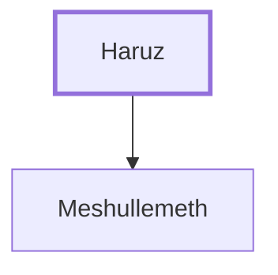

# Haruz

Father of Meshullemeth, wife of King Manasseh.

**Original-language names:** חָרוּץ (H2743)

## When

- **Placed around:** [[connections/timeline/7th century BC|643 BC]] *(Ussher: the median date of the passages naming them)*

## Family

- **Children:** [[connections/people/Meshullemeth|Meshullemeth]]

**Family group:** [[connections/genealogy/Family of Adam|Family of Adam]], generation 1

## Appears in

[[connections/chapters/12-2-kings/2 Kings 21|2 Kings 21]]

## Appears in the same verse as

[[connections/people/Amon (2 Kings 21.18)|Amon (2 Kings 21.18)]] · [[connections/people/Meshullemeth|Meshullemeth]] · [[connections/places/Jerusalem|Jerusalem]] · [[connections/places/Jotbah|Jotbah]]
