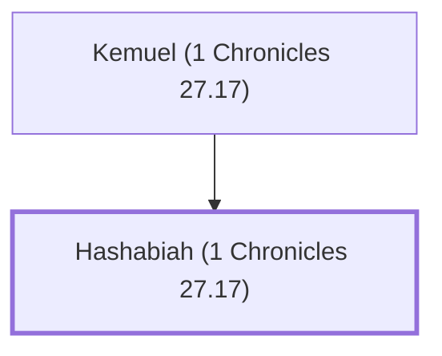

# Hashabiah (1 Chronicles 27.17)

Leader of the Levites during the reign of David.

**Original-language names:** חֲשַׁבְיָ֫הוּ (H2811)

## When

- **Placed around:** [[connections/timeline/11th century BC|1015 BC]] *(Ussher: the median date of the passages naming them)*

## Family

- **Father:** [[connections/people/Kemuel (1 Chronicles 27.17)|Kemuel (1 Chronicles 27.17)]]

**Family group:** [[connections/genealogy/Family of Kemuel (1 Chronicles 27.17)|Family of Kemuel (1 Chronicles 27.17)]], generation 2

## Appears in

[[connections/chapters/13-1-chronicles/1 Chronicles 27|1 Chronicles 27]]

## Appears in the same verse as

[[connections/people/Aaron|Aaron]] · [[connections/people/Kemuel (1 Chronicles 27.17)|Kemuel (1 Chronicles 27.17)]] · [[connections/people/Levi (Genesis 29.34)|Levi (Genesis 29.34)]] · [[connections/people/Zadok (2 Samuel 8.17)|Zadok (2 Samuel 8.17)]]
