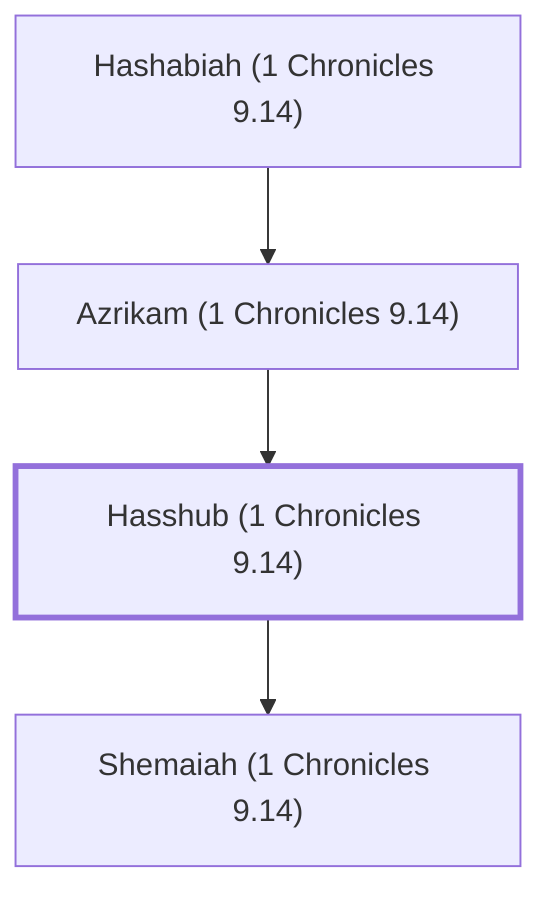

# Hasshub (1 Chronicles 9.14)

A Levite who lived in Jerusalem after the exile.

**Original-language names:** חַשּׁוּב (H2815)

## When

- **Placed around:** [[connections/timeline/5th century BC|445 BC]] *(Ussher: the median date of the passages naming them)*

## Family

- **Father:** [[connections/people/Azrikam (1 Chronicles 9.14)|Azrikam (1 Chronicles 9.14)]]
- **Children:** [[connections/people/Shemaiah (1 Chronicles 9.14)|Shemaiah (1 Chronicles 9.14)]]
- **Tribe or nation:** Tribe of Levi

**Line of descent** (4 generations, father to son): [[connections/people/Bunni (Nehemiah 11.15)|Bunni (Nehemiah 11.15)]] → [[connections/people/Hashabiah (1 Chronicles 9.14)|Hashabiah (1 Chronicles 9.14)]] → [[connections/people/Azrikam (1 Chronicles 9.14)|Azrikam (1 Chronicles 9.14)]] → **Hasshub (1 Chronicles 9.14)**

**Family group:** [[connections/genealogy/Family of Bunni (Nehemiah 11.15)|Family of Bunni (Nehemiah 11.15)]], generation 4

## Appears in

[[connections/chapters/13-1-chronicles/1 Chronicles 9|1 Chronicles 9]] · [[connections/chapters/16-nehemiah/Nehemiah 11|Nehemiah 11]]

## Appears in the same verse as

[[connections/people/Azrikam (1 Chronicles 9.14)|Azrikam (1 Chronicles 9.14) (2)]] · [[connections/people/Hashabiah (1 Chronicles 9.14)|Hashabiah (1 Chronicles 9.14) (2)]] · [[connections/people/Shemaiah (1 Chronicles 9.14)|Shemaiah (1 Chronicles 9.14) (2)]] · [[connections/people/Bunni (Nehemiah 11.15)|Bunni (Nehemiah 11.15)]] · [[connections/people/Merari|Merari]]
