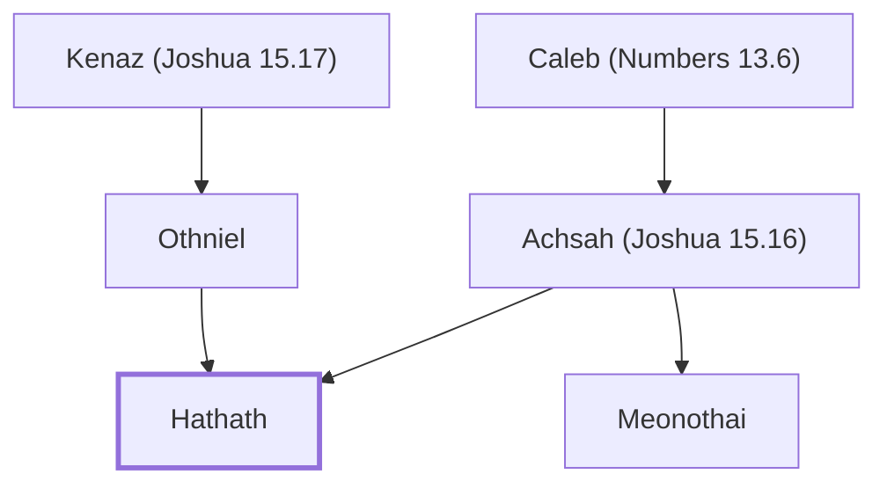

# Hathath

Son of Othniel, from the tribe of Judah.

**Original-language names:** חֲתַת (H2867)

## When

- **Placed around:** [[connections/timeline/18th century BC|1721 BC]] *(Ussher: the median date of the passages naming them)*

## Family

- **Father:** [[connections/people/Othniel|Othniel]]
- **Mother:** [[connections/people/Achsah (Joshua 15.16)|Achsah (Joshua 15.16)]]
- **Brothers and sisters:** [[connections/people/Meonothai|Meonothai (uncertain)]]
- **Tribe or nation:** Tribe of Judah

**Line of descent** (4 generations, father to son): [[connections/people/Jephunneh (Numbers 13.6)|Jephunneh (Numbers 13.6)]] → [[connections/people/Kenaz (Joshua 15.17)|Kenaz (Joshua 15.17)]] → [[connections/people/Othniel|Othniel]] → **Hathath**

**Family group:** [[connections/genealogy/Family of Jephunneh (Numbers 13.6)|Family of Jephunneh (Numbers 13.6)]], generation 4

## Appears in

[[connections/chapters/13-1-chronicles/1 Chronicles 4|1 Chronicles 4]]

## Appears in the same verse as

[[connections/people/Kenaz (Joshua 15.17)|Kenaz (Joshua 15.17)]] · [[connections/people/Othniel|Othniel]] · [[connections/people/Seraiah (1 Chronicles 4.13)|Seraiah (1 Chronicles 4.13)]]
