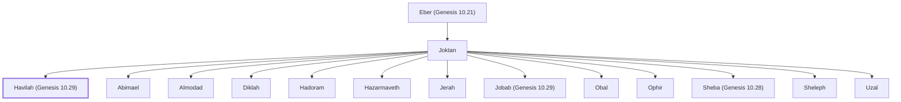

# Havilah (Genesis 10.29)

A son of Joktan, descendant of Shem.

**Original-language names:** חֲוִילָה (H2341)

## When

- **Placed around:** [[connections/timeline/23rd century BC|2207 BC]] *(Ussher: the median date of the passages naming them)*

## Family

- **Father:** [[connections/people/Joktan|Joktan]]
- **Brothers and sisters:** [[connections/people/Abimael|Abimael]], [[connections/people/Almodad|Almodad]], [[connections/people/Diklah|Diklah]], [[connections/people/Hadoram|Hadoram]], [[connections/people/Hazarmaveth|Hazarmaveth]], [[connections/people/Jerah|Jerah]], [[connections/people/Jobab (Genesis 10.29)|Jobab (Genesis 10.29)]], [[connections/people/Obal|Obal]], [[connections/people/Ophir|Ophir]], [[connections/people/Sheba (Genesis 10.28)|Sheba (Genesis 10.28)]], [[connections/people/Sheleph|Sheleph]], [[connections/people/Uzal|Uzal]]
- **Tribe or nation:** Early Patriarch

**Line of descent** (17 generations, father to son): [[connections/people/Adam|Adam]] → [[connections/people/Seth|Seth]] → [[connections/people/Enosh|Enosh]] → [[connections/people/Kenan|Kenan]] → [[connections/people/Mahalalel (Genesis 5.12)|Mahalalel (Genesis 5.12)]] → [[connections/people/Jared|Jared]] → [[connections/people/Enoch (Genesis 5.18)|Enoch (Genesis 5.18)]] → [[connections/people/Methuselah|Methuselah]] → [[connections/people/Lamech (Genesis 5.25)|Lamech (Genesis 5.25)]] → [[connections/people/Noah (Genesis 5.29)|Noah (Genesis 5.29)]] → [[connections/people/Shem|Shem]] → [[connections/people/Arpachshad|Arpachshad]] → [[connections/people/Cainan|Cainan]] → [[connections/people/Shelah (Genesis 10.24)|Shelah (Genesis 10.24)]] → [[connections/people/Eber (Genesis 10.21)|Eber (Genesis 10.21)]] → [[connections/people/Joktan|Joktan]] → **Havilah (Genesis 10.29)**

**Family group:** [[connections/genealogy/Family of Adam|Family of Adam]], generation 17

## Appears in

[[connections/chapters/01-genesis/Genesis 10|Genesis 10]] · [[connections/chapters/13-1-chronicles/1 Chronicles 1|1 Chronicles 1]]

## Appears in the same verse as

[[connections/people/Jobab (Genesis 10.29)|Jobab (Genesis 10.29) (2)]] · [[connections/people/Joktan|Joktan (2)]] · [[connections/people/Ophir|Ophir (2)]]
