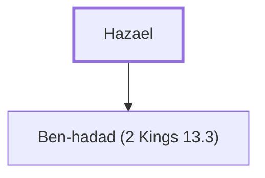

# Hazael

King of Aram (Syria), anointed by Elijah.

**Original-language names:** חֲזָהאֵל (H2371)

## When

- **Placed around:** [[connections/timeline/9th century BC|884 BC]] *(Ussher: the median date of the passages naming them)*
- **Reigned / in office:** c. [[connections/timeline/9th century BC|842 BC]] – [[connections/timeline/8th century BC|796 BC]] *(modern dates)* · Hazael, Aram · [Wikidata Q127170](https://www.wikidata.org/wiki/Q127170)

## Family

- **Children:** [[connections/people/Ben-hadad (2 Kings 13.3)|Ben-hadad (2 Kings 13.3)]]
- **Tribe or nation:** Syria

**Family group:** [[connections/genealogy/Family of Hazael|Family of Hazael]], generation 1

## Appears in

[[connections/chapters/11-1-kings/1 Kings 19|1 Kings 19 (2)]] · [[connections/chapters/12-2-kings/2 Kings 8|2 Kings 8 (7)]] · [[connections/chapters/12-2-kings/2 Kings 9|2 Kings 9 (2)]] · [[connections/chapters/12-2-kings/2 Kings 10|2 Kings 10]] · [[connections/chapters/12-2-kings/2 Kings 12|2 Kings 12 (2)]] · [[connections/chapters/12-2-kings/2 Kings 13|2 Kings 13 (4)]] · [[connections/chapters/14-2-chronicles/2 Chronicles 22|2 Chronicles 22 (2)]] · [[connections/chapters/30-amos/Amos 1|Amos 1]]

## Appears in the same verse as

[[connections/places/Syria|Syria (14)]] · [[connections/people/Israel|Israel (7)]] · [[connections/people/Joram (2 Kings 1.17)|Joram (2 Kings 1.17) (6)]] · [[connections/places/Ramoth|Ramoth (5)]] · [[connections/people/Ahab (1 Kings 16.28)|Ahab (1 Kings 16.28) (4)]] · [[connections/people/Ben-hadad (2 Kings 13.3)|Ben-hadad (2 Kings 13.3) (4)]] · [[connections/people/Ahaziah (2 Kings 8.24)|Ahaziah (2 Kings 8.24) (3)]] · [[connections/people/Jehoram (1 Kings 22.51)|Jehoram (1 Kings 22.51) (3)]] · [[connections/people/Jehu (1 Kings 19.16)|Jehu (1 Kings 19.16) (3)]] · [[connections/people/Judah (Genesis 29.35)|Judah (Genesis 29.35) (3)]] · [[connections/places/Jezreel (Joshua 19.18)|Jezreel (Joshua 19.18) (3)]] · [[connections/people/Elisha|Elisha (2)]] · [[connections/people/Jehoahaz (2 Kings 10.35)|Jehoahaz (2 Kings 10.35) (2)]] · [[connections/places/Damascus|Damascus (2)]] · [[connections/places/Jerusalem|Jerusalem (2)]] · [[connections/people/Ben-hadad (2 Kings 6.24)|Ben-hadad (2 Kings 6.24)]] · [[connections/people/Jehoshaphat (1 Kings 15.24)|Jehoshaphat (1 Kings 15.24)]] · [[connections/people/Jehoshaphat (2 Kings 9.2)|Jehoshaphat (2 Kings 9.2)]] · [[connections/people/Joash (2 Kings 11.2)|Joash (2 Kings 11.2)]] · [[connections/people/Joash (2 Kings 13.9)|Joash (2 Kings 13.9)]] · [[connections/people/Nimshi|Nimshi]] · [[connections/places/Gath|Gath]]
