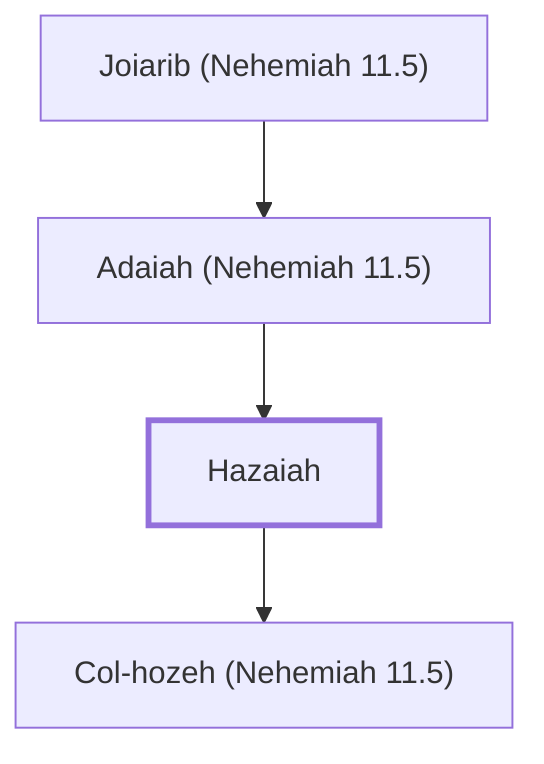

# Hazaiah

Ancestor of Maaseiah, who lived in Jerusalem.

**Original-language names:** חֲזָיָה (H2382)

## When

- **Placed around:** [[connections/timeline/5th century BC|445 BC]] *(Ussher: the median date of the passages naming them)*

## Family

- **Father:** [[connections/people/Adaiah (Nehemiah 11.5)|Adaiah (Nehemiah 11.5)]]
- **Children:** [[connections/people/Col-hozeh (Nehemiah 11.5)|Col-hozeh (Nehemiah 11.5)]]
- **Tribe or nation:** Tribe of Judah

**Line of descent** (4 generations, father to son): [[connections/people/Zechariah (Nehemiah 11.5)|Zechariah (Nehemiah 11.5)]] → [[connections/people/Joiarib (Nehemiah 11.5)|Joiarib (Nehemiah 11.5)]] → [[connections/people/Adaiah (Nehemiah 11.5)|Adaiah (Nehemiah 11.5)]] → **Hazaiah**

**Family group:** [[connections/genealogy/Family of Zechariah (Nehemiah 11.5)|Family of Zechariah (Nehemiah 11.5)]], generation 4

## Appears in

[[connections/chapters/16-nehemiah/Nehemiah 11|Nehemiah 11]]

## Appears in the same verse as

[[connections/people/Adaiah (Nehemiah 11.5)|Adaiah (Nehemiah 11.5)]] · [[connections/people/Baruch (Nehemiah 11.5)|Baruch (Nehemiah 11.5)]] · [[connections/people/Col-hozeh (Nehemiah 11.5)|Col-hozeh (Nehemiah 11.5)]] · [[connections/people/Joiarib (Nehemiah 11.5)|Joiarib (Nehemiah 11.5)]] · [[connections/people/Maaseiah (Nehemiah 11.5)|Maaseiah (Nehemiah 11.5)]] · [[connections/people/Zechariah (Nehemiah 11.5)|Zechariah (Nehemiah 11.5)]]
