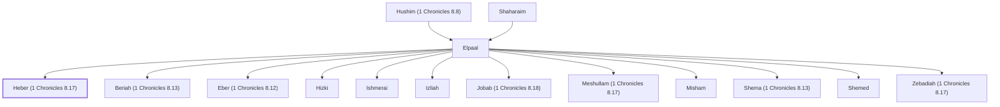

# Heber (1 Chronicles 8.17)

A Benjamite, son of Elpaal.

**Original-language names:** חֶ֫בֶר (H2268)

## Family

- **Father:** [[connections/people/Elpaal|Elpaal]]
- **Brothers and sisters:** [[connections/people/Beriah (1 Chronicles 8.13)|Beriah (1 Chronicles 8.13)]], [[connections/people/Eber (1 Chronicles 8.12)|Eber (1 Chronicles 8.12)]], [[connections/people/Hizki|Hizki]], [[connections/people/Ishmerai|Ishmerai]], [[connections/people/Izliah|Izliah]], [[connections/people/Jobab (1 Chronicles 8.18)|Jobab (1 Chronicles 8.18)]], [[connections/people/Meshullam (1 Chronicles 8.17)|Meshullam (1 Chronicles 8.17)]], [[connections/people/Misham|Misham]], [[connections/people/Shema (1 Chronicles 8.13)|Shema (1 Chronicles 8.13)]], [[connections/people/Shemed|Shemed]], [[connections/people/Zebadiah (1 Chronicles 8.17)|Zebadiah (1 Chronicles 8.17)]]
- **Tribe or nation:** Tribe of Benjamin

**Line of descent** (3 generations, father to son): [[connections/people/Shaharaim|Shaharaim]] → [[connections/people/Elpaal|Elpaal]] → **Heber (1 Chronicles 8.17)**

**Family group:** [[connections/genealogy/Family of Shaharaim|Family of Shaharaim]], generation 3

## Appears in

[[connections/chapters/13-1-chronicles/1 Chronicles 8|1 Chronicles 8]]

## Appears in the same verse as

[[connections/people/Hizki|Hizki]] · [[connections/people/Meshullam (1 Chronicles 8.17)|Meshullam (1 Chronicles 8.17)]] · [[connections/people/Zebadiah (1 Chronicles 8.17)|Zebadiah (1 Chronicles 8.17)]]
