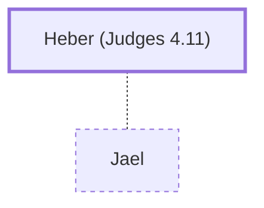

# Heber (Judges 4.11)

A Kenite; husband of Jael.

**Original-language names:** חֶ֫בֶר (H2268)

## When

- **Placed around:** [[connections/timeline/13th century BC|1285 BC]] *(Ussher: the median date of the passages naming them)*

## Family

- **Spouses:** [[connections/people/Jael|Jael]]

## Appears in

[[connections/chapters/07-judges/Judges 4|Judges 4 (3)]] · [[connections/chapters/07-judges/Judges 5|Judges 5]]

## Appears in the same verse as

[[connections/people/Jael|Jael (3)]] · [[connections/people/Hobab|Hobab]] · [[connections/people/Jabin (Judges 4.2)|Jabin (Judges 4.2)]] · [[connections/people/Moses|Moses]] · [[connections/people/Sisera (Judges 4.2)|Sisera (Judges 4.2)]] · [[connections/places/Hazor (Joshua 11.1)|Hazor (Joshua 11.1)]] · [[connections/places/Kedesh|Kedesh]] · [[connections/places/Zaanannim|Zaanannim]]
