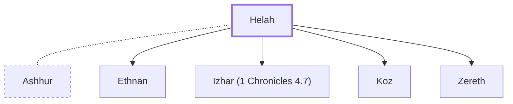

# Helah

One of the two wives of Ashhur.

**Original-language names:** חֶלְאָה (H2458)

## When

- **Placed around:** [[connections/timeline/18th century BC|1721 BC]] *(Ussher: the median date of the passages naming them)*

## Family

- **Spouses:** [[connections/people/Ashhur|Ashhur]]
- **Children:** [[connections/people/Ethnan|Ethnan]], [[connections/people/Izhar (1 Chronicles 4.7)|Izhar (1 Chronicles 4.7)]], [[connections/people/Koz|Koz]], [[connections/people/Zereth|Zereth]]
- **Tribe or nation:** Tribe of Judah(?)

**Family group:** [[connections/genealogy/Family of Adam|Family of Adam]], generation 29

## Appears in

[[connections/chapters/13-1-chronicles/1 Chronicles 4|1 Chronicles 4 (2)]]

## Appears in the same verse as

[[connections/people/Ashhur|Ashhur]] · [[connections/people/Ethnan|Ethnan]] · [[connections/people/Izhar (1 Chronicles 4.7)|Izhar (1 Chronicles 4.7)]] · [[connections/people/Naarah|Naarah]] · [[connections/people/Zereth|Zereth]] · [[connections/places/Tekoa|Tekoa]]
