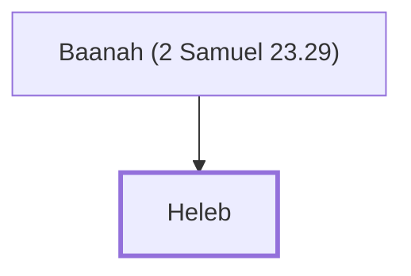

# Heleb

One of David's mighty warriors.

**Also called:** Heldai, Heled

**Original-language names:** חֵ֫לֶב (H2460) · חֶלְדַּי (H2469) · חֵ֫לֶד (H2466)

## When

- **Placed around:** [[connections/timeline/11th century BC|1055 BC]] *(Ussher: the median date of the passages naming them)*

## Family

- **Father:** [[connections/people/Baanah (2 Samuel 23.29)|Baanah (2 Samuel 23.29)]]
- **Tribe or nation:** Tribe of Judah(?)

**Family group:** [[connections/genealogy/Family of Baanah (2 Samuel 23.29)|Family of Baanah (2 Samuel 23.29)]], generation 2

## Appears in

[[connections/chapters/10-2-samuel/2 Samuel 23|2 Samuel 23]] · [[connections/chapters/13-1-chronicles/1 Chronicles 11|1 Chronicles 11]] · [[connections/chapters/13-1-chronicles/1 Chronicles 27|1 Chronicles 27]]

## Appears in the same verse as

[[connections/people/Baanah (2 Samuel 23.29)|Baanah (2 Samuel 23.29) (2)]] · [[connections/people/Benjamin (Genesis 35.18)|Benjamin (Genesis 35.18)]] · [[connections/people/Ittai (2 Samuel 23.29)|Ittai (2 Samuel 23.29)]] · [[connections/people/Maharai|Maharai]] · [[connections/people/Othniel|Othniel]] · [[connections/people/Ribai|Ribai]] · [[connections/places/Gibeah (Joshua 18.28)|Gibeah (Joshua 18.28)]]
