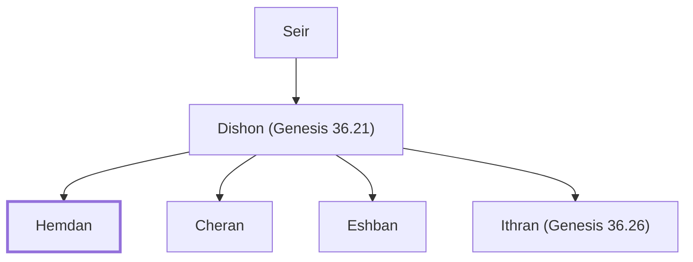

# Hemdan

A descendant of Seir the Horite.

**Also called:** Hamran

**Original-language names:** חֶמְדָּן (H2533) · חַמְרָן (H2566)

## When

- **Placed around:** [[connections/timeline/18th century BC|1756 BC]] *(Ussher: the median date of the passages naming them)*

## Family

- **Father:** [[connections/people/Dishon (Genesis 36.21)|Dishon (Genesis 36.21)]]
- **Brothers and sisters:** [[connections/people/Cheran|Cheran]], [[connections/people/Eshban|Eshban]], [[connections/people/Ithran (Genesis 36.26)|Ithran (Genesis 36.26)]]
- **Tribe or nation:** Edom

**Line of descent** (3 generations, father to son): [[connections/people/Seir|Seir]] → [[connections/people/Dishon (Genesis 36.21)|Dishon (Genesis 36.21)]] → **Hemdan**

**Family group:** [[connections/genealogy/Family of Adam|Family of Adam]], generation 3

## Appears in

[[connections/chapters/01-genesis/Genesis 36|Genesis 36]] · [[connections/chapters/13-1-chronicles/1 Chronicles 1|1 Chronicles 1]]

## Appears in the same verse as

[[connections/people/Cheran|Cheran (2)]] · [[connections/people/Dishon (Genesis 36.21)|Dishon (Genesis 36.21) (2)]] · [[connections/people/Eshban|Eshban (2)]] · [[connections/people/Ithran (Genesis 36.26)|Ithran (Genesis 36.26) (2)]] · [[connections/people/Anah|Anah]] · [[connections/people/Dishon (Genesis 36.25)|Dishon (Genesis 36.25)]]
