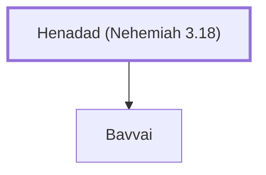

# Henadad (Nehemiah 3.18)

Son of Binnui, a Levite who repaired the wall.

**Original-language names:** חֵנָדָד (H2582)

## When

- **Placed around:** [[connections/timeline/5th century BC|445 BC]] *(Ussher: the median date of the passages naming them)*

## Family

- **Children:** [[connections/people/Bavvai|Bavvai]]

**Family group:** [[connections/genealogy/Family of Henadad (Nehemiah 3.18)|Family of Henadad (Nehemiah 3.18)]], generation 1

## Appears in

[[connections/chapters/16-nehemiah/Nehemiah 3|Nehemiah 3]]

## Appears in the same verse as

[[connections/people/Bavvai|Bavvai]] · [[connections/places/Keilah|Keilah]]
