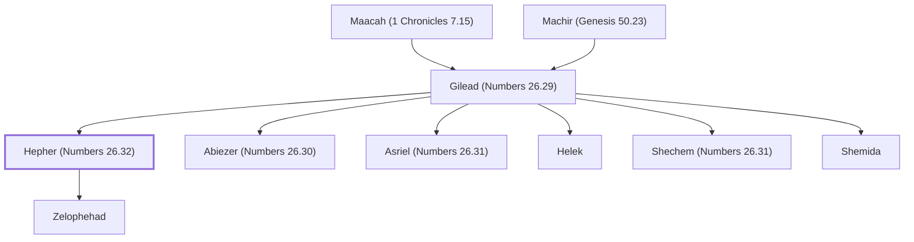

# Hepher (Numbers 26.32)

Son of Gilead, ancestor of the Hepherites.

**Original-language names:** חֵ֫פֶר (H2660a)

## When

- **Placed around:** [[connections/timeline/15th century BC|1452 BC]] *(Ussher: the median date of the passages naming them)*

## Family

- **Father:** [[connections/people/Gilead (Numbers 26.29)|Gilead (Numbers 26.29)]]
- **Brothers and sisters:** [[connections/people/Abiezer (Numbers 26.30)|Abiezer (Numbers 26.30)]], [[connections/people/Asriel (Numbers 26.31)|Asriel (Numbers 26.31)]], [[connections/people/Helek|Helek]], [[connections/people/Shechem (Numbers 26.31)|Shechem (Numbers 26.31)]], [[connections/people/Shemida|Shemida]]
- **Children:** [[connections/people/Zelophehad|Zelophehad]]
- **Tribe or nation:** Tribe of Manasseh

**Line of descent** (28 generations, father to son): [[connections/people/Adam|Adam]] → [[connections/people/Seth|Seth]] → [[connections/people/Enosh|Enosh]] → [[connections/people/Kenan|Kenan]] → [[connections/people/Mahalalel (Genesis 5.12)|Mahalalel (Genesis 5.12)]] → [[connections/people/Jared|Jared]] → [[connections/people/Enoch (Genesis 5.18)|Enoch (Genesis 5.18)]] → [[connections/people/Methuselah|Methuselah]] → [[connections/people/Lamech (Genesis 5.25)|Lamech (Genesis 5.25)]] → [[connections/people/Noah (Genesis 5.29)|Noah (Genesis 5.29)]] → [[connections/people/Shem|Shem]] → [[connections/people/Arpachshad|Arpachshad]] → [[connections/people/Cainan|Cainan]] → [[connections/people/Shelah (Genesis 10.24)|Shelah (Genesis 10.24)]] → [[connections/people/Eber (Genesis 10.21)|Eber (Genesis 10.21)]] → [[connections/people/Peleg|Peleg]] → [[connections/people/Reu|Reu]] → [[connections/people/Serug|Serug]] → [[connections/people/Nahor (Genesis 11.22)|Nahor (Genesis 11.22)]] → [[connections/people/Terah|Terah]] → [[connections/people/Abraham|Abraham]] → [[connections/people/Isaac|Isaac]] → [[connections/people/Israel|Israel]] → [[connections/people/Joseph (Genesis 30.24)|Joseph (Genesis 30.24)]] → [[connections/people/Manasseh (Genesis 41.51)|Manasseh (Genesis 41.51)]] → [[connections/people/Machir (Genesis 50.23)|Machir (Genesis 50.23)]] → [[connections/people/Gilead (Numbers 26.29)|Gilead (Numbers 26.29)]] → **Hepher (Numbers 26.32)**

**Family group:** [[connections/genealogy/Family of Adam|Family of Adam]], generation 28

## Appears in

[[connections/chapters/04-numbers/Numbers 26|Numbers 26 (2)]] · [[connections/chapters/04-numbers/Numbers 27|Numbers 27]] · [[connections/chapters/06-joshua/Joshua 17|Joshua 17 (2)]]

## Appears in the same verse as

[[connections/people/Hoglah|Hoglah (3)]] · [[connections/people/Mahlah (Numbers 26.33)|Mahlah (Numbers 26.33) (3)]] · [[connections/people/Manasseh (Genesis 41.51)|Manasseh (Genesis 41.51) (3)]] · [[connections/people/Milcah (Numbers 26.33)|Milcah (Numbers 26.33) (3)]] · [[connections/people/Noah (Numbers 26.33)|Noah (Numbers 26.33) (3)]] · [[connections/people/Tirzah|Tirzah (3)]] · [[connections/people/Zelophehad|Zelophehad (3)]] · [[connections/people/Gilead (Numbers 26.29)|Gilead (Numbers 26.29) (2)]] · [[connections/people/Joseph (Genesis 30.24)|Joseph (Genesis 30.24) (2)]] · [[connections/people/Machir (Genesis 50.23)|Machir (Genesis 50.23) (2)]] · [[connections/people/Shemida|Shemida (2)]] · [[connections/people/Abiezer (Numbers 26.30)|Abiezer (Numbers 26.30)]] · [[connections/people/Asriel (Numbers 26.31)|Asriel (Numbers 26.31)]] · [[connections/people/Helek|Helek]] · [[connections/people/Shechem (Numbers 26.31)|Shechem (Numbers 26.31)]]
