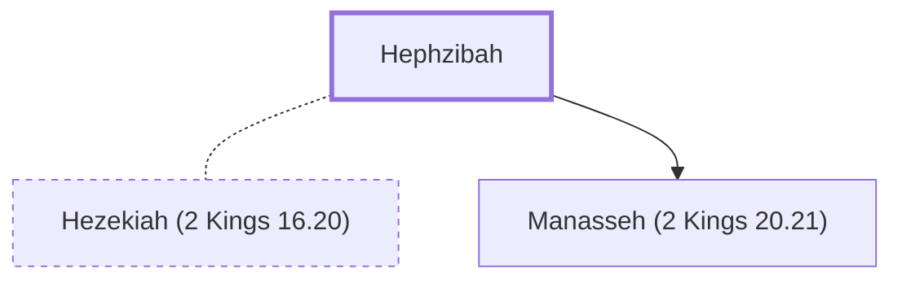

# Hephzibah

The mother of King Manasseh of Judah.

**Original-language names:** חֶפְצִי־בָהּ (H2657)

## When

- **Placed around:** [[connections/timeline/7th century BC|698 BC]] *(Ussher: the median date of the passages naming them)*

## Family

- **Spouses:** [[connections/people/Hezekiah (2 Kings 16.20)|Hezekiah (2 Kings 16.20)]]
- **Children:** [[connections/people/Manasseh (2 Kings 20.21)|Manasseh (2 Kings 20.21)]]

**Family group:** [[connections/genealogy/Family of Adam|Family of Adam]], generation 50

## Appears in

[[connections/chapters/12-2-kings/2 Kings 21|2 Kings 21]]

## Appears in the same verse as

[[connections/people/Manasseh (2 Kings 20.21)|Manasseh (2 Kings 20.21)]] · [[connections/places/Jerusalem|Jerusalem]]
