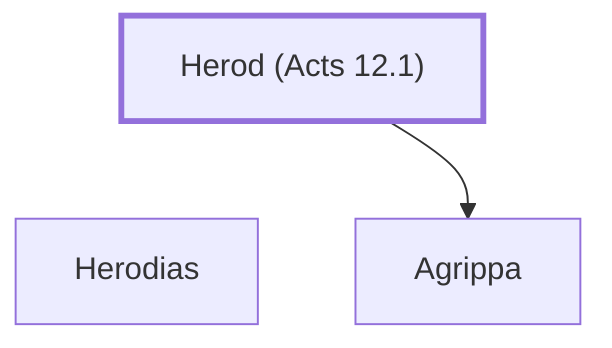

# Herod (Acts 12.1)

A Tetrarch who persecuted the early church.

**Original-language names:** Ἡρώδης (G2264)

## When

- **Placed around:** [[connections/timeline/1st century AD|AD 44]] *(Ussher: the median date of the passages naming them)*
- **Reigned / in office:** [[connections/timeline/1st century AD|AD 41]] – [[connections/timeline/1st century AD|AD 44]] *(modern dates)* · Herod Agrippa I, Herodian · [Wikidata Q298636](https://www.wikidata.org/wiki/Q298636) · King of Judea

## Family

- **Brothers and sisters:** [[connections/people/Herodias|Herodias]]
- **Children:** [[connections/people/Agrippa|Agrippa]]
- **Tribe or nation:** Canaan

**Family group:** [[connections/genealogy/Family of Herod (Acts 12.1)|Family of Herod (Acts 12.1)]], generation 1

## Appears in

[[connections/chapters/44-acts/Acts 12|Acts 12 (6)]]

## Appears in the same verse as

[[connections/people/Peter|Peter (2)]] · [[connections/people/Blastus|Blastus]] · [[connections/places/Caesarea|Caesarea]] · [[connections/places/Judea|Judea]] · [[connections/places/Tyre|Tyre]]
