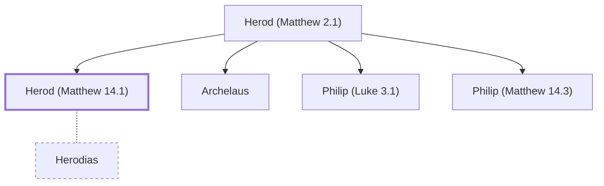

# Herod (Matthew 14.1)

Tetrarch of Galilee during Jesus' ministry.

**Original-language names:** Ἡρώδης (G2264)

## When

- **Placed around:** [[connections/timeline/1st century AD|AD 32]] *(Ussher: the median date of the passages naming them)*
- **Reigned / in office:** [[connections/timeline/1st century BC|4 BC]] – [[connections/timeline/1st century AD|AD 39]] *(modern dates)* · Herod Antipas, Herodian · [Wikidata Q192950](https://www.wikidata.org/wiki/Q192950) · Tetrarch of Galilee and Perea

## Family

- **Father:** [[connections/people/Herod (Matthew 2.1)|Herod (Matthew 2.1)]]
- **Brothers and sisters:** [[connections/people/Archelaus|Archelaus]], [[connections/people/Philip (Luke 3.1)|Philip (Luke 3.1)]], [[connections/people/Philip (Matthew 14.3)|Philip (Matthew 14.3)]]
- **Spouses:** [[connections/people/Herodias|Herodias]]
- **Tribe or nation:** Ammon

**Family group:** [[connections/genealogy/Family of Herod (Matthew 2.1)|Family of Herod (Matthew 2.1)]], generation 2

## Appears in

[[connections/chapters/40-matthew/Matthew 14|Matthew 14 (3)]] · [[connections/chapters/41-mark/Mark 6|Mark 6 (7)]] · [[connections/chapters/41-mark/Mark 8|Mark 8]] · [[connections/chapters/42-luke/Luke 3|Luke 3 (2)]] · [[connections/chapters/42-luke/Luke 8|Luke 8]] · [[connections/chapters/42-luke/Luke 9|Luke 9 (2)]] · [[connections/chapters/42-luke/Luke 13|Luke 13]] · [[connections/chapters/42-luke/Luke 23|Luke 23 (5)]] · [[connections/chapters/44-acts/Acts 4|Acts 4]] · [[connections/chapters/44-acts/Acts 13|Acts 13]]

## Appears in the same verse as

[[connections/people/John (Matthew 3.1)|John (Matthew 3.1) (8)]] · [[connections/people/Herodias|Herodias (5)]] · [[connections/people/Pilate|Pilate (4)]] · [[connections/people/Jesus|Jesus (3)]] · [[connections/people/Philip (Matthew 14.3)|Philip (Matthew 14.3) (3)]] · [[connections/places/Galilee|Galilee (2)]] · [[connections/people/Augustus|Augustus]] · [[connections/people/Barnabas|Barnabas]] · [[connections/people/Chuza|Chuza]] · [[connections/people/Israel|Israel]] · [[connections/people/Joanna|Joanna]] · [[connections/people/Lucius|Lucius]] · [[connections/people/Lysanias|Lysanias]] · [[connections/people/Manaen|Manaen]] · [[connections/people/Paul|Paul]] · [[connections/people/Philip (Luke 3.1)|Philip (Luke 3.1)]] · [[connections/people/Simeon (Acts 13.1)|Simeon (Acts 13.1)]] · [[connections/people/Susanna|Susanna]] · [[connections/people/Tiberius|Tiberius]] · [[connections/places/Abilene|Abilene]] · [[connections/places/Antioch (Acts 11.19)|Antioch (Acts 11.19)]] · [[connections/places/Cyrene|Cyrene]] · [[connections/places/Jerusalem|Jerusalem]] · [[connections/places/Jetur|Jetur]] · [[connections/places/Judea|Judea]] · [[connections/places/Trachonitis|Trachonitis]]
