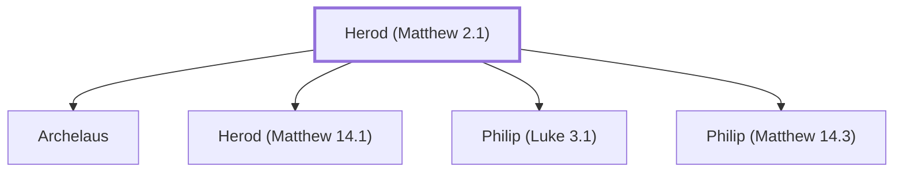

# Herod (Matthew 2.1)

The Great, Roman-appointed king of Judea during Jesus' birth.

**Original-language names:** Ἡρώδης (G2264)

## When

- **Placed around:** [[connections/timeline/1st century BC|4 BC]] *(Ussher: the median date of the passages naming them)*
- **Reigned / in office:** [[connections/timeline/1st century BC|37 BC]] – [[connections/timeline/1st century BC|4 BC]] *(modern dates)* · Herod the Great, Herodian · [Wikidata Q51672](https://www.wikidata.org/wiki/Q51672)

## Family

- **Children:** [[connections/people/Archelaus|Archelaus]], [[connections/people/Herod (Matthew 14.1)|Herod (Matthew 14.1)]], [[connections/people/Philip (Luke 3.1)|Philip (Luke 3.1)]], [[connections/people/Philip (Matthew 14.3)|Philip (Matthew 14.3)]]
- **Tribe or nation:** Canaan

**Family group:** [[connections/genealogy/Family of Herod (Matthew 2.1)|Family of Herod (Matthew 2.1)]], generation 1

## Events

- [[connections/timeline/1st century BC|4 BC]] · [[connections/events/Wise Men Visit Herod|Wise Men Visit Herod]]
- [[connections/timeline/1st century BC|4 BC]] · [[connections/events/Herod slays male children|Herod slays male children]]

## Appears in

[[connections/chapters/40-matthew/Matthew 2|Matthew 2 (9)]] · [[connections/chapters/42-luke/Luke 1|Luke 1]] · [[connections/chapters/44-acts/Acts 23|Acts 23]]

## Appears in the same verse as

[[connections/places/Egypt|Egypt (3)]] · [[connections/places/Judea|Judea (3)]] · [[connections/people/Joseph (Matthew 1.16)|Joseph (Matthew 1.16) (2)]] · [[connections/places/Bethlehem (Genesis 35.16)|Bethlehem (Genesis 35.16) (2)]] · [[connections/places/Jerusalem|Jerusalem (2)]] · [[connections/people/Aaron|Aaron]] · [[connections/people/Abijah (1 Chronicles 24.10)|Abijah (1 Chronicles 24.10)]] · [[connections/people/Archelaus|Archelaus]] · [[connections/people/Elizabeth|Elizabeth]] · [[connections/people/Jesus|Jesus]] · [[connections/people/Zechariah (Luke 1.5)|Zechariah (Luke 1.5)]] · [[connections/places/Galilee|Galilee]]
