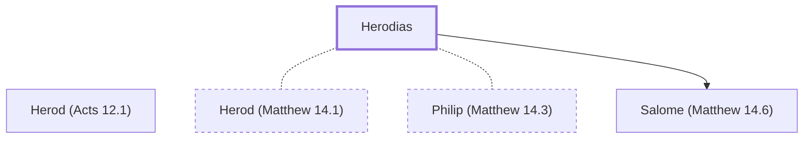

# Herodias

Wife of Herod Antipas who had John beheaded.

**Original-language names:** Ἡρωδιάς (G2266)

## When

- **Placed around:** [[connections/timeline/1st century AD|AD 28]] *(Ussher: the median date of the passages naming them)*

## Family

- **Brothers and sisters:** [[connections/people/Herod (Acts 12.1)|Herod (Acts 12.1)]]
- **Spouses:** [[connections/people/Herod (Matthew 14.1)|Herod (Matthew 14.1)]], [[connections/people/Philip (Matthew 14.3)|Philip (Matthew 14.3)]]
- **Children:** [[connections/people/Salome (Matthew 14.6)|Salome (Matthew 14.6)]]

**Family group:** [[connections/genealogy/Family of Herod (Matthew 2.1)|Family of Herod (Matthew 2.1)]], generation 2

## Appears in

[[connections/chapters/40-matthew/Matthew 14|Matthew 14 (2)]] · [[connections/chapters/41-mark/Mark 6|Mark 6 (3)]] · [[connections/chapters/42-luke/Luke 3|Luke 3]]

## Appears in the same verse as

[[connections/people/Herod (Matthew 14.1)|Herod (Matthew 14.1) (5)]] · [[connections/people/Philip (Matthew 14.3)|Philip (Matthew 14.3) (3)]] · [[connections/people/John (Matthew 3.1)|John (Matthew 3.1) (2)]]
