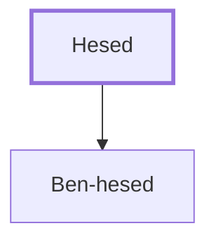

# Hesed

A district overseer under Solomon.

**Original-language names:** חֶ֫סֶד (H2618)

## When

- **Placed around:** [[connections/timeline/11th century BC|1014 BC]] *(Ussher: the median date of the passages naming them)*

## Family

- **Children:** [[connections/people/Ben-hesed|Ben-hesed]]

**Family group:** [[connections/genealogy/Family of Hesed|Family of Hesed]], generation 1

## Appears in

[[connections/chapters/11-1-kings/1 Kings 4|1 Kings 4]]

## Appears in the same verse as

[[connections/people/Ben-hesed|Ben-hesed]] · [[connections/places/Arubboth|Arubboth]] · [[connections/places/Hepher|Hepher]] · [[connections/places/Socoh (Joshua 15.35)|Socoh (Joshua 15.35)]]
