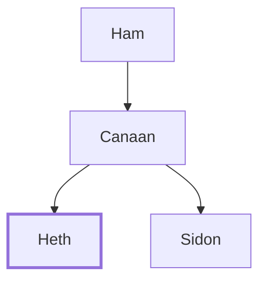

# Heth

Son of Canaan and ancestor of the Hittites.

**Original-language names:** חֵת (H2845)

## When

- **Placed around:** [[connections/timeline/19th century BC|1860 BC]] *(Ussher: the median date of the passages naming them)*

## Family

- **Father:** [[connections/people/Canaan|Canaan]]
- **Brothers and sisters:** [[connections/people/Sidon|Sidon]]
- **Tribe or nation:** Early Patriarch

**Line of descent** (13 generations, father to son): [[connections/people/Adam|Adam]] → [[connections/people/Seth|Seth]] → [[connections/people/Enosh|Enosh]] → [[connections/people/Kenan|Kenan]] → [[connections/people/Mahalalel (Genesis 5.12)|Mahalalel (Genesis 5.12)]] → [[connections/people/Jared|Jared]] → [[connections/people/Enoch (Genesis 5.18)|Enoch (Genesis 5.18)]] → [[connections/people/Methuselah|Methuselah]] → [[connections/people/Lamech (Genesis 5.25)|Lamech (Genesis 5.25)]] → [[connections/people/Noah (Genesis 5.29)|Noah (Genesis 5.29)]] → [[connections/people/Ham|Ham]] → [[connections/people/Canaan|Canaan]] → **Heth**

**Family group:** [[connections/genealogy/Family of Adam|Family of Adam]], generation 13

## Appears in

[[connections/chapters/01-genesis/Genesis 10|Genesis 10]] · [[connections/chapters/01-genesis/Genesis 23|Genesis 23 (7)]] · [[connections/chapters/01-genesis/Genesis 25|Genesis 25]] · [[connections/chapters/01-genesis/Genesis 27|Genesis 27]] · [[connections/chapters/01-genesis/Genesis 49|Genesis 49]] · [[connections/chapters/13-1-chronicles/1 Chronicles 1|1 Chronicles 1]]

## Appears in the same verse as

[[connections/people/Abraham|Abraham (8)]] · [[connections/people/Canaan|Canaan (2)]] · [[connections/people/Ephron|Ephron (2)]] · [[connections/people/Sidon|Sidon (2)]] · [[connections/people/Isaac|Isaac]] · [[connections/people/Israel|Israel]] · [[connections/people/Rebekah|Rebekah]] · [[connections/people/Sarah|Sarah]]
