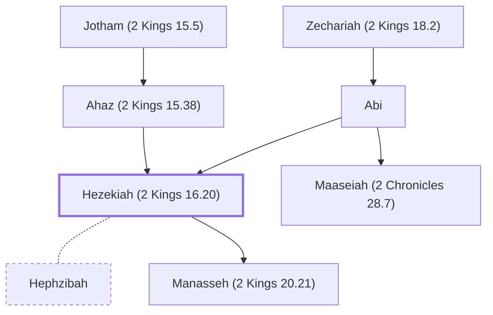

# Hezekiah (2 Kings 16.20)

A righteous king of Judah.

**Also called:** Jehezekiah

**Original-language names:** חִזְקִיָּהוּ (H2396) · יְחִזְקִיָּה (H3169) · Ἐζεκίας (G1478)

## When

- **Lived:** [[connections/timeline/8th century BC|752 BC]] – [[connections/timeline/7th century BC|697 BC]] *(Jones)*
- **Placed around:** [[connections/timeline/8th century BC|712 BC]] *(Ussher: the median date of the passages naming them)*

## Family

- **Father:** [[connections/people/Ahaz (2 Kings 15.38)|Ahaz (2 Kings 15.38)]]
- **Mother:** [[connections/people/Abi|Abi]]
- **Brothers and sisters:** [[connections/people/Maaseiah (2 Chronicles 28.7)|Maaseiah (2 Chronicles 28.7)]]
- **Spouses:** [[connections/people/Hephzibah|Hephzibah]]
- **Children:** [[connections/people/Manasseh (2 Kings 20.21)|Manasseh (2 Kings 20.21)]]
- **Tribe or nation:** Tribe of Judah

**Line of descent** (47 generations, father to son): [[connections/people/Adam|Adam]] → [[connections/people/Seth|Seth]] → [[connections/people/Enosh|Enosh]] → [[connections/people/Kenan|Kenan]] → [[connections/people/Mahalalel (Genesis 5.12)|Mahalalel (Genesis 5.12)]] → [[connections/people/Jared|Jared]] → [[connections/people/Enoch (Genesis 5.18)|Enoch (Genesis 5.18)]] → [[connections/people/Methuselah|Methuselah]] → [[connections/people/Lamech (Genesis 5.25)|Lamech (Genesis 5.25)]] → [[connections/people/Noah (Genesis 5.29)|Noah (Genesis 5.29)]] → [[connections/people/Shem|Shem]] → [[connections/people/Arpachshad|Arpachshad]] → [[connections/people/Cainan|Cainan]] → [[connections/people/Shelah (Genesis 10.24)|Shelah (Genesis 10.24)]] → [[connections/people/Eber (Genesis 10.21)|Eber (Genesis 10.21)]] → [[connections/people/Peleg|Peleg]] → [[connections/people/Reu|Reu]] → [[connections/people/Serug|Serug]] → [[connections/people/Nahor (Genesis 11.22)|Nahor (Genesis 11.22)]] → [[connections/people/Terah|Terah]] → [[connections/people/Abraham|Abraham]] → [[connections/people/Isaac|Isaac]] → [[connections/people/Israel|Israel]] → [[connections/people/Judah (Genesis 29.35)|Judah (Genesis 29.35)]] → [[connections/people/Perez|Perez]] → [[connections/people/Hezron (Genesis 46.12)|Hezron (Genesis 46.12)]] → [[connections/people/Ram (Ruth 4.19)|Ram (Ruth 4.19)]] → [[connections/people/Amminadab (Exodus 6.23)|Amminadab (Exodus 6.23)]] → [[connections/people/Nahshon|Nahshon]] → [[connections/people/Salmon|Salmon]] → [[connections/people/Boaz|Boaz]] → [[connections/people/Obed (Ruth 4.17)|Obed (Ruth 4.17)]] → [[connections/people/Jesse|Jesse]] → [[connections/people/David|David]] → [[connections/people/Solomon|Solomon]] → [[connections/people/Rehoboam|Rehoboam]] → [[connections/people/Abijah (1 Kings 14.31)|Abijah (1 Kings 14.31)]] → [[connections/people/Asa (1 Kings 15.8)|Asa (1 Kings 15.8)]] → [[connections/people/Jehoshaphat (1 Kings 15.24)|Jehoshaphat (1 Kings 15.24)]] → [[connections/people/Jehoram (1 Kings 22.51)|Jehoram (1 Kings 22.51)]] → [[connections/people/Ahaziah (2 Kings 8.24)|Ahaziah (2 Kings 8.24)]] → [[connections/people/Joash (2 Kings 11.2)|Joash (2 Kings 11.2)]] → [[connections/people/Amaziah (2 Kings 12.22)|Amaziah (2 Kings 12.22)]] → [[connections/people/Uzziah (2 Kings 14.21)|Uzziah (2 Kings 14.21)]] → [[connections/people/Jotham (2 Kings 15.5)|Jotham (2 Kings 15.5)]] → [[connections/people/Ahaz (2 Kings 15.38)|Ahaz (2 Kings 15.38)]] → **Hezekiah (2 Kings 16.20)**

**Family group:** [[connections/genealogy/Family of Adam|Family of Adam]], generation 47

## Events

- [[connections/timeline/8th century BC|726 BC]] · [[connections/events/Reign of Hezekiah|Reign of Hezekiah]]
- [[connections/timeline/7th century BC|697 BC]] · [[connections/events/Death of Hezekiah|Death of Hezekiah]]

## Appears in

[[connections/chapters/12-2-kings/2 Kings 16|2 Kings 16]] · [[connections/chapters/12-2-kings/2 Kings 18|2 Kings 18 (15)]] · [[connections/chapters/12-2-kings/2 Kings 19|2 Kings 19 (8)]] · [[connections/chapters/12-2-kings/2 Kings 20|2 Kings 20 (13)]] · [[connections/chapters/12-2-kings/2 Kings 21|2 Kings 21]] · [[connections/chapters/13-1-chronicles/1 Chronicles 3|1 Chronicles 3]] · [[connections/chapters/13-1-chronicles/1 Chronicles 4|1 Chronicles 4]] · [[connections/chapters/14-2-chronicles/2 Chronicles 28|2 Chronicles 28]] · [[connections/chapters/14-2-chronicles/2 Chronicles 29|2 Chronicles 29 (7)]] · [[connections/chapters/14-2-chronicles/2 Chronicles 30|2 Chronicles 30 (5)]] · [[connections/chapters/14-2-chronicles/2 Chronicles 31|2 Chronicles 31 (6)]] · [[connections/chapters/14-2-chronicles/2 Chronicles 32|2 Chronicles 32 (18)]] · [[connections/chapters/14-2-chronicles/2 Chronicles 33|2 Chronicles 33]] · [[connections/chapters/20-proverbs/Proverbs 25|Proverbs 25]] · [[connections/chapters/23-isaiah/Isaiah 1|Isaiah 1]] · [[connections/chapters/23-isaiah/Isaiah 36|Isaiah 36 (9)]] · [[connections/chapters/23-isaiah/Isaiah 37|Isaiah 37 (8)]] · [[connections/chapters/23-isaiah/Isaiah 38|Isaiah 38 (6)]] · [[connections/chapters/23-isaiah/Isaiah 39|Isaiah 39 (6)]] · [[connections/chapters/24-jeremiah/Jeremiah 15|Jeremiah 15]] · [[connections/chapters/24-jeremiah/Jeremiah 26|Jeremiah 26 (2)]] · [[connections/chapters/28-hosea/Hosea 1|Hosea 1]] · [[connections/chapters/33-micah/Micah 1|Micah 1]] · [[connections/chapters/40-matthew/Matthew 1|Matthew 1 (2)]]

## Appears in the same verse as

[[connections/people/Judah (Genesis 29.35)|Judah (Genesis 29.35) (29)]] · [[connections/places/Assyria|Assyria (21)]] · [[connections/places/Jerusalem|Jerusalem (21)]] · [[connections/people/Isaiah|Isaiah (16)]] · [[connections/people/Israel|Israel (14)]] · [[connections/people/Ahaz (2 Kings 15.38)|Ahaz (2 Kings 15.38) (8)]] · [[connections/people/Amoz|Amoz (7)]] · [[connections/people/David|David (7)]] · [[connections/people/Sennacherib|Sennacherib (7)]] · [[connections/people/Rabshakeh|Rabshakeh (6)]] · [[connections/people/Manasseh (2 Kings 20.21)|Manasseh (2 Kings 20.21) (5)]] · [[connections/people/Jotham (2 Kings 15.5)|Jotham (2 Kings 15.5) (4)]] · [[connections/places/Babylon|Babylon (4)]] · [[connections/places/Lachish|Lachish (4)]] · [[connections/people/Hoshea (2 Kings 15.30)|Hoshea (2 Kings 15.30) (3)]] · [[connections/people/Uzziah (2 Kings 14.21)|Uzziah (2 Kings 14.21) (3)]] · [[connections/places/Samaria|Samaria (3)]] · [[connections/people/Asaph (2 Kings 18.18)|Asaph (2 Kings 18.18) (2)]] · [[connections/people/Baladan|Baladan (2)]] · [[connections/people/Elah (2 Kings 15.30)|Elah (2 Kings 15.30) (2)]] · [[connections/people/Eliakim (2 Kings 18.18)|Eliakim (2 Kings 18.18) (2)]] · [[connections/people/Ephraim|Ephraim (2)]] · [[connections/people/Hilkiah (2 Kings 18.18)|Hilkiah (2 Kings 18.18) (2)]] · [[connections/people/Joah (2 Kings 18.18)|Joah (2 Kings 18.18) (2)]] · [[connections/people/Manasseh (Genesis 41.51)|Manasseh (Genesis 41.51) (2)]] · [[connections/people/Merodach-baladan|Merodach-baladan (2)]] · [[connections/people/Micah (Jeremiah 26.18)|Micah (Jeremiah 26.18) (2)]] · [[connections/people/Shebna|Shebna (2)]] · [[connections/people/Tirhakah|Tirhakah (2)]] · [[connections/places/Cush|Cush (2)]] · [[connections/places/Washer's Field|Washer's Field (2)]] · [[connections/people/Abi|Abi]] · [[connections/people/Ahab (1 Kings 16.28)|Ahab (1 Kings 16.28)]] · [[connections/people/Amon (2 Kings 21.18)|Amon (2 Kings 21.18)]] · [[connections/people/Asahel (2 Chronicles 31.13)|Asahel (2 Chronicles 31.13)]] · [[connections/people/Asaph (1 Chronicles 6.24)|Asaph (1 Chronicles 6.24)]] · [[connections/people/Azariah (2 Chronicles 31.10)|Azariah (2 Chronicles 31.10)]] · [[connections/people/Azaziah (2 Chronicles 31.13)|Azaziah (2 Chronicles 31.13)]] · [[connections/people/Beeri (Hosea 1.1)|Beeri (Hosea 1.1)]] · [[connections/people/Benaiah (2 Chronicles 31.13)|Benaiah (2 Chronicles 31.13)]] · [[connections/people/Conaniah|Conaniah]] · [[connections/people/Eliel (2 Chronicles 31.13)|Eliel (2 Chronicles 31.13)]] · [[connections/people/Hosea|Hosea]] · [[connections/people/Ismachiah|Ismachiah]] · [[connections/people/Issachar (Genesis 30.18)|Issachar (Genesis 30.18)]] · [[connections/people/Jehiel (2 Chronicles 31.13)|Jehiel (2 Chronicles 31.13)]] · [[connections/people/Jerimoth (2 Chronicles 31.13)|Jerimoth (2 Chronicles 31.13)]] · [[connections/people/Jeroboam (2 Kings 13.13)|Jeroboam (2 Kings 13.13)]] · [[connections/people/Joash (2 Kings 13.9)|Joash (2 Kings 13.9)]] · [[connections/people/Josiah (1 Kings 13.2)|Josiah (1 Kings 13.2)]] · [[connections/people/Jozabad (2 Chronicles 31.13)|Jozabad (2 Chronicles 31.13)]] · [[connections/people/Mahath (2 Chronicles 31.13)|Mahath (2 Chronicles 31.13)]] · [[connections/people/Meunites|Meunites]] · [[connections/people/Nahath (2 Chronicles 31.13)|Nahath (2 Chronicles 31.13)]] · [[connections/people/Rab-saris (2 Kings 18.17)|Rab-saris (2 Kings 18.17)]] · [[connections/people/Shalmaneser|Shalmaneser]] · [[connections/people/Shimei (2 Chronicles 31.12)|Shimei (2 Chronicles 31.12)]] · [[connections/people/Solomon|Solomon]] · [[connections/people/Tartan|Tartan]] · [[connections/people/Zebulun|Zebulun]] · [[connections/people/Zechariah (2 Kings 18.2)|Zechariah (2 Kings 18.2)]] · [[connections/places/Gihon|Gihon]]
