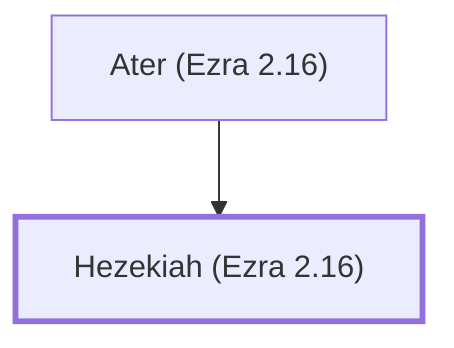

# Hezekiah (Ezra 2.16)

Ancestor of exiles who returned to Jerusalem.

**Also called:** Jehezekiah

**Original-language names:** חִזְקִיָּהוּ (H2396) · יְחִזְקִיָּה (H3169)

## When

- **Placed around:** [[connections/timeline/5th century BC|445 BC]] *(Ussher: the median date of the passages naming them)*

## Family

- **Father:** [[connections/people/Ater (Ezra 2.16)|Ater (Ezra 2.16)]]

**Family group:** [[connections/genealogy/Family of Ater (Ezra 2.16)|Family of Ater (Ezra 2.16)]], generation 2

## Appears in

[[connections/chapters/15-ezra/Ezra 2|Ezra 2]] · [[connections/chapters/16-nehemiah/Nehemiah 7|Nehemiah 7]]

## Appears in the same verse as

[[connections/people/Ater (Ezra 2.16)|Ater (Ezra 2.16) (2)]]
