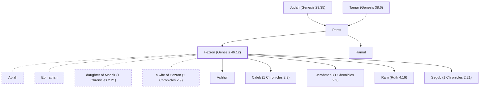

# Hezron (Genesis 46.12)

Son of Perez, grandson of Judah, ancestor of David.

**Original-language names:** חֶצְרוֹן (H2696) · Ἐσρώμ (G2074)

## When

- **Placed around:** [[connections/timeline/15th century BC|1470 BC]] *(Ussher: the median date of the passages naming them)*

## Family

- **Father:** [[connections/people/Perez|Perez]]
- **Brothers and sisters:** [[connections/people/Hamul|Hamul]]
- **Spouses:** [[connections/people/Abiah|Abiah]], [[connections/people/Ephrathah|Ephrathah]], [[connections/people/daughter of Machir (1 Chronicles 2.21)|daughter of Machir (1 Chronicles 2.21)]], [[connections/people/a wife of Hezron (1 Chronicles 2.9)|a wife of Hezron (1 Chronicles 2.9)]]
- **Children:** [[connections/people/Ashhur|Ashhur]], [[connections/people/Caleb (1 Chronicles 2.9)|Caleb (1 Chronicles 2.9)]], [[connections/people/Jerahmeel (1 Chronicles 2.9)|Jerahmeel (1 Chronicles 2.9)]], [[connections/people/Ram (Ruth 4.19)|Ram (Ruth 4.19)]], [[connections/people/Segub (1 Chronicles 2.21)|Segub (1 Chronicles 2.21)]]
- **Tribe or nation:** Tribe of Judah

**Line of descent** (26 generations, father to son): [[connections/people/Adam|Adam]] → [[connections/people/Seth|Seth]] → [[connections/people/Enosh|Enosh]] → [[connections/people/Kenan|Kenan]] → [[connections/people/Mahalalel (Genesis 5.12)|Mahalalel (Genesis 5.12)]] → [[connections/people/Jared|Jared]] → [[connections/people/Enoch (Genesis 5.18)|Enoch (Genesis 5.18)]] → [[connections/people/Methuselah|Methuselah]] → [[connections/people/Lamech (Genesis 5.25)|Lamech (Genesis 5.25)]] → [[connections/people/Noah (Genesis 5.29)|Noah (Genesis 5.29)]] → [[connections/people/Shem|Shem]] → [[connections/people/Arpachshad|Arpachshad]] → [[connections/people/Cainan|Cainan]] → [[connections/people/Shelah (Genesis 10.24)|Shelah (Genesis 10.24)]] → [[connections/people/Eber (Genesis 10.21)|Eber (Genesis 10.21)]] → [[connections/people/Peleg|Peleg]] → [[connections/people/Reu|Reu]] → [[connections/people/Serug|Serug]] → [[connections/people/Nahor (Genesis 11.22)|Nahor (Genesis 11.22)]] → [[connections/people/Terah|Terah]] → [[connections/people/Abraham|Abraham]] → [[connections/people/Isaac|Isaac]] → [[connections/people/Israel|Israel]] → [[connections/people/Judah (Genesis 29.35)|Judah (Genesis 29.35)]] → [[connections/people/Perez|Perez]] → **Hezron (Genesis 46.12)**

**Family group:** [[connections/genealogy/Family of Adam|Family of Adam]], generation 26

## Appears in

[[connections/chapters/01-genesis/Genesis 46|Genesis 46]] · [[connections/chapters/04-numbers/Numbers 26|Numbers 26]] · [[connections/chapters/08-ruth/Ruth 4|Ruth 4 (2)]] · [[connections/chapters/13-1-chronicles/1 Chronicles 2|1 Chronicles 2 (6)]] · [[connections/chapters/13-1-chronicles/1 Chronicles 4|1 Chronicles 4]] · [[connections/chapters/40-matthew/Matthew 1|Matthew 1]] · [[connections/chapters/42-luke/Luke 3|Luke 3]]

## Appears in the same verse as

[[connections/people/Perez|Perez (7)]] · [[connections/people/Caleb (1 Chronicles 2.9)|Caleb (1 Chronicles 2.9) (4)]] · [[connections/people/Judah (Genesis 29.35)|Judah (Genesis 29.35) (4)]] · [[connections/people/Ram (Ruth 4.19)|Ram (Ruth 4.19) (4)]] · [[connections/people/Hamul|Hamul (3)]] · [[connections/people/Amminadab (Exodus 6.23)|Amminadab (Exodus 6.23) (2)]] · [[connections/people/Jerahmeel (1 Chronicles 2.9)|Jerahmeel (1 Chronicles 2.9) (2)]] · [[connections/people/Zerah (Genesis 38.30)|Zerah (Genesis 38.30) (2)]] · [[connections/people/Abiah|Abiah]] · [[connections/people/Ahijah (1 Chronicles 2.25)|Ahijah (1 Chronicles 2.25)]] · [[connections/people/Ardon|Ardon]] · [[connections/people/Ashhur|Ashhur]] · [[connections/people/Azubah (1 Chronicles 2.18)|Azubah (1 Chronicles 2.18)]] · [[connections/people/Bunah|Bunah]] · [[connections/people/Ephrathah|Ephrathah]] · [[connections/people/Er (Genesis 38.3)|Er (Genesis 38.3)]] · [[connections/people/Gilead (Numbers 26.29)|Gilead (Numbers 26.29)]] · [[connections/people/Hur (Exodus 17.10)|Hur (Exodus 17.10)]] · [[connections/people/Jerioth|Jerioth]] · [[connections/people/Jesher|Jesher]] · [[connections/people/Machir (Genesis 50.23)|Machir (Genesis 50.23)]] · [[connections/people/Onan|Onan]] · [[connections/people/Oren|Oren]] · [[connections/people/Ozem (1 Chronicles 2.25)|Ozem (1 Chronicles 2.25)]] · [[connections/people/Ram (1 Chronicles 2.25)|Ram (1 Chronicles 2.25)]] · [[connections/people/Segub (1 Chronicles 2.21)|Segub (1 Chronicles 2.21)]] · [[connections/people/Shelah (Genesis 38.5)|Shelah (Genesis 38.5)]] · [[connections/people/Shobab (1 Chronicles 2.18)|Shobab (1 Chronicles 2.18)]] · [[connections/people/Shobal (1 Chronicles 2.50)|Shobal (1 Chronicles 2.50)]] · [[connections/people/Tamar (Genesis 38.6)|Tamar (Genesis 38.6)]] · [[connections/places/Caleb Ephrathah|Caleb Ephrathah]] · [[connections/places/Canaan|Canaan]] · [[connections/places/Tekoa|Tekoa]]
