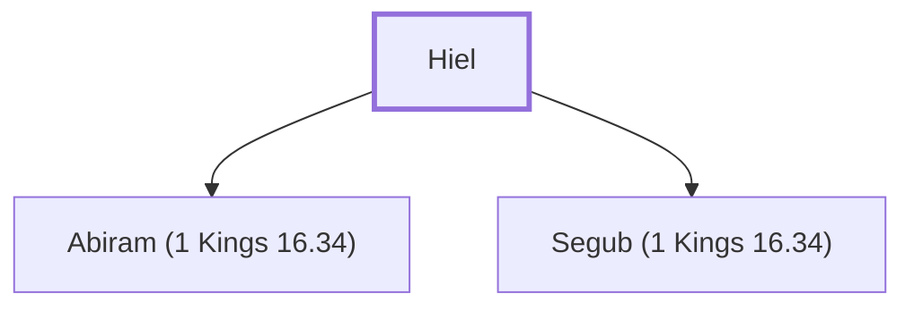

# Hiel

The Bethelite who rebuilt Jericho.

**Original-language names:** חִיאֵל (H2419)

## When

- **Placed around:** [[connections/timeline/10th century BC|918 BC]] *(Ussher: the median date of the passages naming them)*

## Family

- **Children:** [[connections/people/Abiram (1 Kings 16.34)|Abiram (1 Kings 16.34)]], [[connections/people/Segub (1 Kings 16.34)|Segub (1 Kings 16.34)]]

**Family group:** [[connections/genealogy/Family of Hiel|Family of Hiel]], generation 1

## Appears in

[[connections/chapters/11-1-kings/1 Kings 16|1 Kings 16]]

## Appears in the same verse as

[[connections/people/Abiram (1 Kings 16.34)|Abiram (1 Kings 16.34)]] · [[connections/people/Joshua (Exodus 17.9)|Joshua (Exodus 17.9)]] · [[connections/people/Nun|Nun]] · [[connections/people/Segub (1 Kings 16.34)|Segub (1 Kings 16.34)]] · [[connections/places/Bethel (Genesis 12.8)|Bethel (Genesis 12.8)]] · [[connections/places/Jericho|Jericho]]
