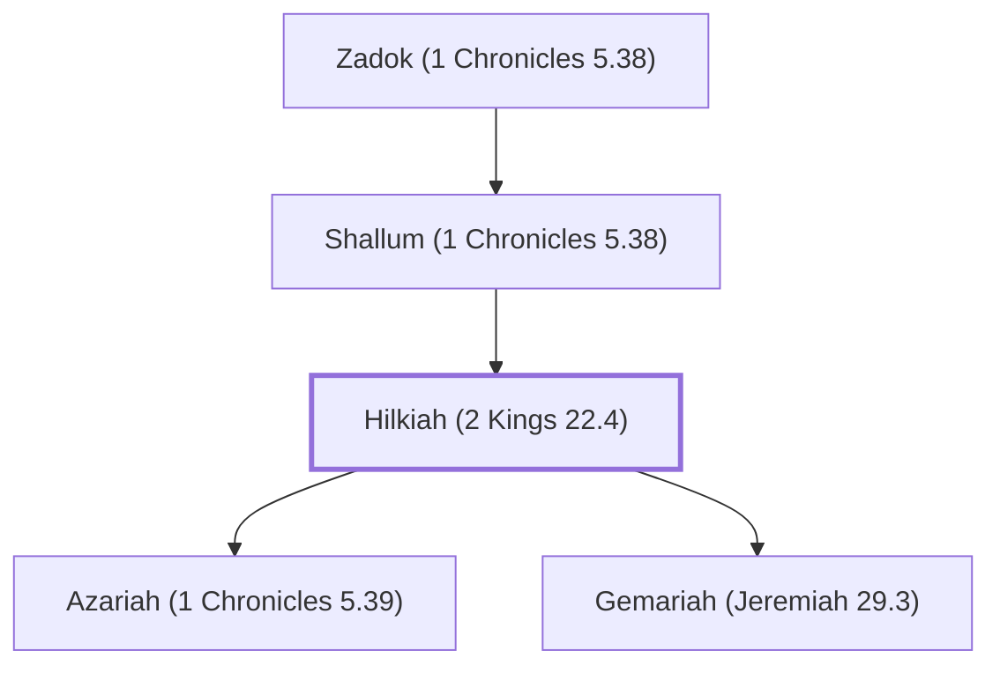

# Hilkiah (2 Kings 22.4)

The high priest who discovered the Book of the Law.

**Original-language names:** חִלְקִיָּהוּ (H2518)

## When

- **Placed around:** [[connections/timeline/7th century BC|624 BC]] *(Ussher: the median date of the passages naming them)*

## Family

- **Father:** [[connections/people/Shallum (1 Chronicles 5.38)|Shallum (1 Chronicles 5.38)]]
- **Children:** [[connections/people/Azariah (1 Chronicles 5.39)|Azariah (1 Chronicles 5.39)]], [[connections/people/Gemariah (Jeremiah 29.3)|Gemariah (Jeremiah 29.3)]]
- **Tribe or nation:** Tribe of Levi

**Line of descent** (46 generations, father to son): [[connections/people/Adam|Adam]] → [[connections/people/Seth|Seth]] → [[connections/people/Enosh|Enosh]] → [[connections/people/Kenan|Kenan]] → [[connections/people/Mahalalel (Genesis 5.12)|Mahalalel (Genesis 5.12)]] → [[connections/people/Jared|Jared]] → [[connections/people/Enoch (Genesis 5.18)|Enoch (Genesis 5.18)]] → [[connections/people/Methuselah|Methuselah]] → [[connections/people/Lamech (Genesis 5.25)|Lamech (Genesis 5.25)]] → [[connections/people/Noah (Genesis 5.29)|Noah (Genesis 5.29)]] → [[connections/people/Shem|Shem]] → [[connections/people/Arpachshad|Arpachshad]] → [[connections/people/Cainan|Cainan]] → [[connections/people/Shelah (Genesis 10.24)|Shelah (Genesis 10.24)]] → [[connections/people/Eber (Genesis 10.21)|Eber (Genesis 10.21)]] → [[connections/people/Peleg|Peleg]] → [[connections/people/Reu|Reu]] → [[connections/people/Serug|Serug]] → [[connections/people/Nahor (Genesis 11.22)|Nahor (Genesis 11.22)]] → [[connections/people/Terah|Terah]] → [[connections/people/Abraham|Abraham]] → [[connections/people/Isaac|Isaac]] → [[connections/people/Israel|Israel]] → [[connections/people/Levi (Genesis 29.34)|Levi (Genesis 29.34)]] → [[connections/people/Kohath|Kohath]] → [[connections/people/Amram (Exodus 6.18)|Amram (Exodus 6.18)]] → [[connections/people/Aaron|Aaron]] → [[connections/people/Eleazar (Exodus 6.23)|Eleazar (Exodus 6.23)]] → [[connections/people/Phinehas (Exodus 6.25)|Phinehas (Exodus 6.25)]] → [[connections/people/Abishua (1 Chronicles 5.30)|Abishua (1 Chronicles 5.30)]] → [[connections/people/Bukki (1 Chronicles 5.31)|Bukki (1 Chronicles 5.31)]] → [[connections/people/Uzzi (1 Chronicles 5.31)|Uzzi (1 Chronicles 5.31)]] → [[connections/people/Zerahiah (1 Chronicles 5.32)|Zerahiah (1 Chronicles 5.32)]] → [[connections/people/Meraioth|Meraioth]] → [[connections/people/Amariah (1 Chronicles 5.33)|Amariah (1 Chronicles 5.33)]] → [[connections/people/Ahitub (2 Samuel 8.17)|Ahitub (2 Samuel 8.17)]] → [[connections/people/Zadok (2 Samuel 8.17)|Zadok (2 Samuel 8.17)]] → [[connections/people/Ahimaaz (2 Samuel 15.27)|Ahimaaz (2 Samuel 15.27)]] → [[connections/people/Azariah (1 Kings 4.2)|Azariah (1 Kings 4.2)]] → [[connections/people/Johanan (1 Chronicles 5.35)|Johanan (1 Chronicles 5.35)]] → [[connections/people/Azariah (1 Chronicles 5.36)|Azariah (1 Chronicles 5.36)]] → [[connections/people/Amariah (1 Chronicles 5.37)|Amariah (1 Chronicles 5.37)]] → [[connections/people/Ahitub (1 Chronicles 5.37)|Ahitub (1 Chronicles 5.37)]] → [[connections/people/Zadok (1 Chronicles 5.38)|Zadok (1 Chronicles 5.38)]] → [[connections/people/Shallum (1 Chronicles 5.38)|Shallum (1 Chronicles 5.38)]] → **Hilkiah (2 Kings 22.4)**

**Family group:** [[connections/genealogy/Family of Adam|Family of Adam]], generation 46

## Appears in

[[connections/chapters/12-2-kings/2 Kings 22|2 Kings 22 (5)]] · [[connections/chapters/12-2-kings/2 Kings 23|2 Kings 23 (2)]] · [[connections/chapters/13-1-chronicles/1 Chronicles 5|1 Chronicles 5]] · [[connections/chapters/13-1-chronicles/1 Chronicles 9|1 Chronicles 9]] · [[connections/chapters/14-2-chronicles/2 Chronicles 34|2 Chronicles 34 (6)]] · [[connections/chapters/14-2-chronicles/2 Chronicles 35|2 Chronicles 35]] · [[connections/chapters/15-ezra/Ezra 7|Ezra 7]] · [[connections/chapters/16-nehemiah/Nehemiah 11|Nehemiah 11]] · [[connections/chapters/24-jeremiah/Jeremiah 29|Jeremiah 29]]

## Appears in the same verse as

[[connections/people/Shaphan (2 Kings 22.3)|Shaphan (2 Kings 22.3) (8)]] · [[connections/places/Jerusalem|Jerusalem (5)]] · [[connections/people/Achbor (2 Kings 22.12)|Achbor (2 Kings 22.12) (3)]] · [[connections/people/Ahikam|Ahikam (3)]] · [[connections/people/Asaiah (2 Kings 22.12)|Asaiah (2 Kings 22.12) (3)]] · [[connections/people/Azariah (1 Chronicles 5.39)|Azariah (1 Chronicles 5.39) (3)]] · [[connections/people/Judah (Genesis 29.35)|Judah (Genesis 29.35) (3)]] · [[connections/people/Shallum (1 Chronicles 5.38)|Shallum (1 Chronicles 5.38) (3)]] · [[connections/people/Harhas|Harhas (2)]] · [[connections/people/Huldah|Huldah (2)]] · [[connections/people/Meraioth|Meraioth (2)]] · [[connections/people/Micaiah (2 Kings 22.12)|Micaiah (2 Kings 22.12) (2)]] · [[connections/people/Seraiah (2 Kings 25.18)|Seraiah (2 Kings 25.18) (2)]] · [[connections/people/Shallum (2 Kings 22.14)|Shallum (2 Kings 22.14) (2)]] · [[connections/people/Tikvah (2 Kings 22.14)|Tikvah (2 Kings 22.14) (2)]] · [[connections/people/Zadok (1 Chronicles 5.38)|Zadok (1 Chronicles 5.38) (2)]] · [[connections/people/Zerahiah (1 Chronicles 5.32)|Zerahiah (1 Chronicles 5.32) (2)]] · [[connections/places/Second Quarter|Second Quarter (2)]] · [[connections/people/Artaxerxes|Artaxerxes]] · [[connections/people/Benjamin (Genesis 35.18)|Benjamin (Genesis 35.18)]] · [[connections/people/Elasah (Jeremiah 29.3)|Elasah (Jeremiah 29.3)]] · [[connections/people/Ephraim|Ephraim]] · [[connections/people/Ezra (Ezra 7.1)|Ezra (Ezra 7.1)]] · [[connections/people/Gemariah (Jeremiah 29.3)|Gemariah (Jeremiah 29.3)]] · [[connections/people/Israel|Israel]] · [[connections/people/Jehiel (2 Chronicles 35.8)|Jehiel (2 Chronicles 35.8)]] · [[connections/people/Josiah (1 Kings 13.2)|Josiah (1 Kings 13.2)]] · [[connections/people/Manasseh (Genesis 41.51)|Manasseh (Genesis 41.51)]] · [[connections/people/Moses|Moses]] · [[connections/people/Nebuchadnezzar|Nebuchadnezzar]] · [[connections/people/Zechariah (2 Chronicles 35.8)|Zechariah (2 Chronicles 35.8)]] · [[connections/people/Zedekiah (2 Kings 24.17)|Zedekiah (2 Kings 24.17)]] · [[connections/places/Babylon|Babylon]] · [[connections/places/Bethel (Genesis 12.8)|Bethel (Genesis 12.8)]] · [[connections/places/Kidron|Kidron]] · [[connections/places/Persia|Persia]]
