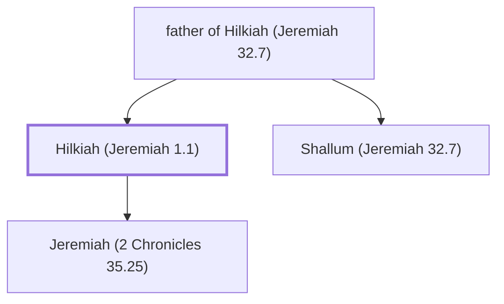

# Hilkiah (Jeremiah 1.1)

The father of the prophet Jeremiah.

**Original-language names:** חִלְקִיָּהוּ (H2518)

## When

- **Placed around:** [[connections/timeline/7th century BC|629 BC]] *(Ussher: the median date of the passages naming them)*

## Family

- **Father:** [[connections/people/father of Hilkiah (Jeremiah 32.7)|father of Hilkiah (Jeremiah 32.7)]]
- **Brothers and sisters:** [[connections/people/Shallum (Jeremiah 32.7)|Shallum (Jeremiah 32.7)]]
- **Children:** [[connections/people/Jeremiah (2 Chronicles 35.25)|Jeremiah (2 Chronicles 35.25)]]

**Family group:** [[connections/genealogy/Family of father of Hilkiah (Jeremiah 32.7)|Family of father of Hilkiah (Jeremiah 32.7)]], generation 2

## Appears in

[[connections/chapters/24-jeremiah/Jeremiah 1|Jeremiah 1]]

## Appears in the same verse as

[[connections/people/Benjamin (Genesis 35.18)|Benjamin (Genesis 35.18)]] · [[connections/people/Jeremiah (2 Chronicles 35.25)|Jeremiah (2 Chronicles 35.25)]] · [[connections/places/Anathoth|Anathoth]]
