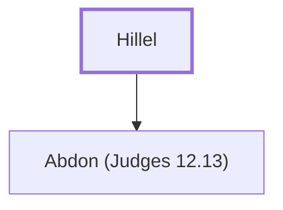

# Hillel

Fatther of the judge Abdon

**Original-language names:** הִלֵּל (H1985)

## When

- **Placed around:** [[connections/timeline/12th century BC|1156 BC]] *(Ussher: the median date of the passages naming them)*

## Family

- **Children:** [[connections/people/Abdon (Judges 12.13)|Abdon (Judges 12.13)]]

**Family group:** [[connections/genealogy/Family of Hillel|Family of Hillel]], generation 1

## Appears in

[[connections/chapters/07-judges/Judges 12|Judges 12 (2)]]

## Appears in the same verse as

[[connections/people/Abdon (Judges 12.13)|Abdon (Judges 12.13) (2)]] · [[connections/people/Ephraim|Ephraim]] · [[connections/people/Israel|Israel]] · [[connections/places/Pirathon|Pirathon]]
