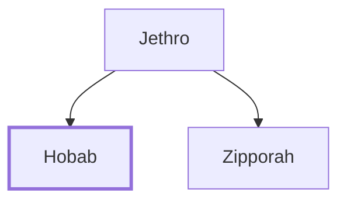

# Hobab

Moses' brother-in-law, a Midianite.

**Original-language names:** חֹבָב (H2246)

## When

- **Placed around:** [[connections/timeline/13th century BC|1285 BC]] *(Ussher: the median date of the passages naming them)*

## Family

- **Father:** [[connections/people/Jethro|Jethro]]
- **Brothers and sisters:** [[connections/people/Zipporah|Zipporah]]
- **Tribe or nation:** Midian

**Family group:** [[connections/genealogy/Family of Adam|Family of Adam]], generation 2

## Appears in

[[connections/chapters/04-numbers/Numbers 10|Numbers 10]] · [[connections/chapters/07-judges/Judges 4|Judges 4]]

## Appears in the same verse as

[[connections/people/Moses|Moses (2)]] · [[connections/people/Heber (Judges 4.11)|Heber (Judges 4.11)]] · [[connections/people/Israel|Israel]] · [[connections/people/Jethro|Jethro]] · [[connections/places/Kedesh|Kedesh]] · [[connections/places/Zaanannim|Zaanannim]]
