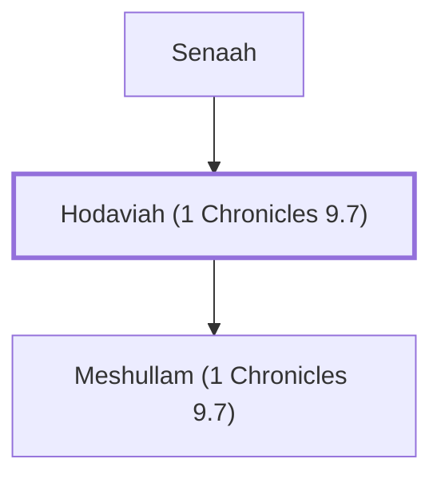

# Hodaviah (1 Chronicles 9.7)

A Benjamite who lived in Jerusalem.

**Original-language names:** הוֹדַוְיָה (H1938)

## When

- **Placed around:** [[connections/timeline/6th century BC|536 BC]] *(Ussher: the median date of the passages naming them)*

## Family

- **Father:** [[connections/people/Senaah|Senaah (descendants)]]
- **Children:** [[connections/people/Meshullam (1 Chronicles 9.7)|Meshullam (1 Chronicles 9.7)]]
- **Tribe or nation:** Tribe of Benjamin

**Family group:** [[connections/genealogy/Family of Senaah|Family of Senaah]], generation 2

## Appears in

[[connections/chapters/13-1-chronicles/1 Chronicles 9|1 Chronicles 9]]

## Appears in the same verse as

[[connections/people/Benjamin (Genesis 35.18)|Benjamin (Genesis 35.18)]] · [[connections/people/Meshullam (1 Chronicles 9.7)|Meshullam (1 Chronicles 9.7)]] · [[connections/people/Sallu (1 Chronicles 9.7)|Sallu (1 Chronicles 9.7)]]
