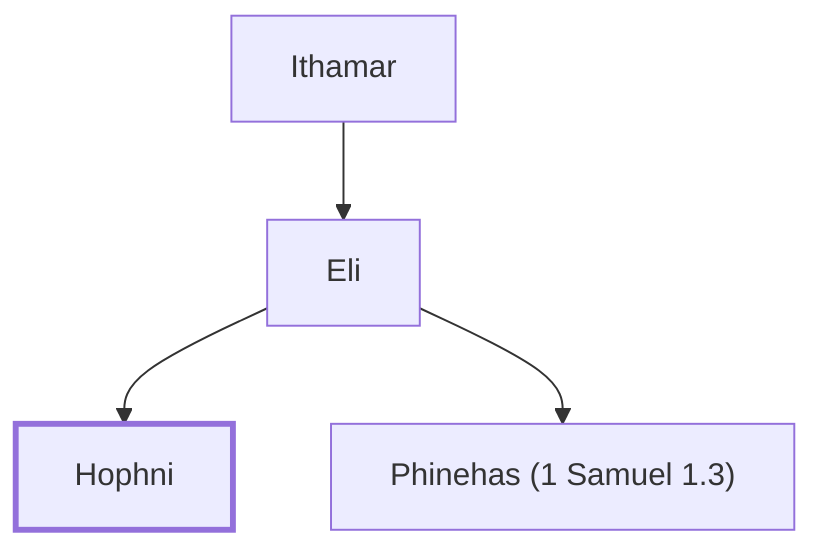

# Hophni

A corrupt priest, son of Eli.

**Original-language names:** חׇפְנִי (H2652)

## When

- **Placed around:** [[connections/timeline/12th century BC|1141 BC]] *(Ussher: the median date of the passages naming them)*

## Family

- **Father:** [[connections/people/Eli|Eli]]
- **Brothers and sisters:** [[connections/people/Phinehas (1 Samuel 1.3)|Phinehas (1 Samuel 1.3)]]
- **Tribe or nation:** Tribe of Levi

**Family group:** [[connections/genealogy/Family of Adam|Family of Adam]], generation 34

## Appears in

[[connections/chapters/09-1-samuel/1 Samuel 1|1 Samuel 1]] · [[connections/chapters/09-1-samuel/1 Samuel 2|1 Samuel 2]] · [[connections/chapters/09-1-samuel/1 Samuel 4|1 Samuel 4 (3)]]

## Appears in the same verse as

[[connections/people/Phinehas (1 Samuel 1.3)|Phinehas (1 Samuel 1.3) (5)]] · [[connections/people/Eli|Eli (3)]] · [[connections/places/Shiloh|Shiloh (2)]] · [[connections/people/Israel|Israel]]
