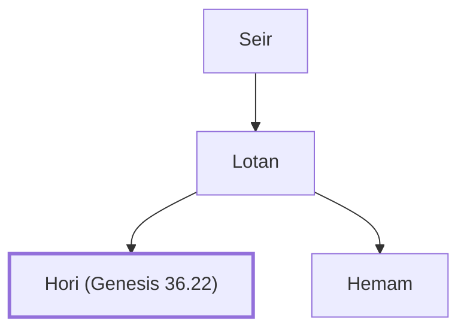

# Hori (Genesis 36.22)

A Horite people group.

**Original-language names:** חֹרִי (H2753)

## When

- **Placed around:** [[connections/timeline/18th century BC|1756 BC]] *(Ussher: the median date of the passages naming them)*

## Family

- **Father:** [[connections/people/Lotan|Lotan]]
- **Brothers and sisters:** [[connections/people/Hemam|Hemam]]
- **Tribe or nation:** Edom

**Line of descent** (3 generations, father to son): [[connections/people/Seir|Seir]] → [[connections/people/Lotan|Lotan]] → **Hori (Genesis 36.22)**

**Family group:** [[connections/genealogy/Family of Adam|Family of Adam]], generation 3

## Appears in

[[connections/chapters/01-genesis/Genesis 36|Genesis 36 (2)]] · [[connections/chapters/13-1-chronicles/1 Chronicles 1|1 Chronicles 1]]

## Appears in the same verse as

[[connections/people/Hemam|Hemam (2)]] · [[connections/people/Lotan|Lotan (2)]] · [[connections/people/Timna|Timna (2)]] · [[connections/people/Dishan|Dishan]] · [[connections/people/Dishon (Genesis 36.21)|Dishon (Genesis 36.21)]] · [[connections/people/Ezer (Genesis 36.21)|Ezer (Genesis 36.21)]] · [[connections/places/Seir|Seir]]
