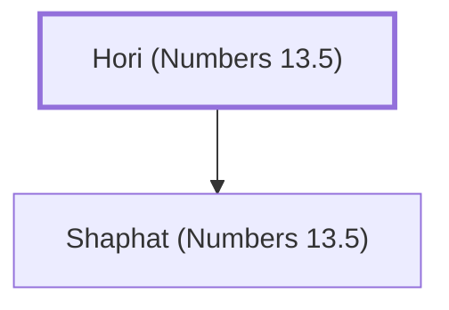

# Hori (Numbers 13.5)

A spy from the tribe of Simeon.

**Original-language names:** חֹרִי (H2753)

## When

- **Placed around:** [[connections/timeline/15th century BC|1490 BC]] *(Ussher: the median date of the passages naming them)*

## Family

- **Children:** [[connections/people/Shaphat (Numbers 13.5)|Shaphat (Numbers 13.5)]]

**Family group:** [[connections/genealogy/Family of Hori (Numbers 13.5)|Family of Hori (Numbers 13.5)]], generation 1

## Appears in

[[connections/chapters/04-numbers/Numbers 13|Numbers 13]]

## Appears in the same verse as

[[connections/people/Shaphat (Numbers 13.5)|Shaphat (Numbers 13.5)]] · [[connections/people/Simeon (Genesis 29.33)|Simeon (Genesis 29.33)]]
