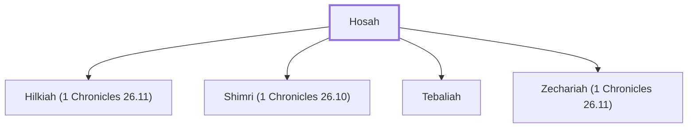

# Hosah

A Levite gatekeeper during David's reign.

**Original-language names:** חֹסָה (H2621)

## When

- **Placed around:** [[connections/timeline/11th century BC|1015 BC]] *(Ussher: the median date of the passages naming them)*

## Family

- **Children:** [[connections/people/Hilkiah (1 Chronicles 26.11)|Hilkiah (1 Chronicles 26.11)]], [[connections/people/Shimri (1 Chronicles 26.10)|Shimri (1 Chronicles 26.10)]], [[connections/people/Tebaliah|Tebaliah]], [[connections/people/Zechariah (1 Chronicles 26.11)|Zechariah (1 Chronicles 26.11)]]

**Family group:** [[connections/genealogy/Family of Hosah|Family of Hosah]], generation 1

## Appears in

[[connections/chapters/13-1-chronicles/1 Chronicles 16|1 Chronicles 16]] · [[connections/chapters/13-1-chronicles/1 Chronicles 26|1 Chronicles 26 (3)]]

## Appears in the same verse as

[[connections/people/Hilkiah (1 Chronicles 26.11)|Hilkiah (1 Chronicles 26.11)]] · [[connections/people/Jeduthun (1 Chronicles 6.29)|Jeduthun (1 Chronicles 6.29)]] · [[connections/people/Merari|Merari]] · [[connections/people/Obed-edom|Obed-edom]] · [[connections/people/Shimri (1 Chronicles 26.10)|Shimri (1 Chronicles 26.10)]] · [[connections/people/Shuppim (1 Chronicles 26.16)|Shuppim (1 Chronicles 26.16)]] · [[connections/people/Tebaliah|Tebaliah]] · [[connections/people/Zechariah (1 Chronicles 26.11)|Zechariah (1 Chronicles 26.11)]] · [[connections/places/Shallecheth|Shallecheth]]
