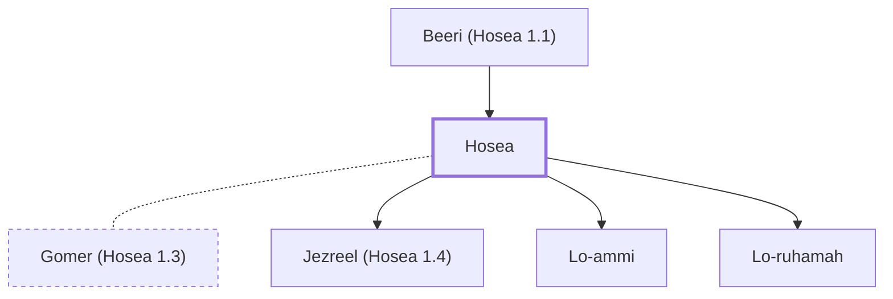

# Hosea

A prophet to the northern kingdom of Israel.

**Original-language names:** הוֹשֵׁעַ (H1954) · Ὡσηέ (G5617)

## When

- **Placed around:** [[connections/timeline/8th century BC|785 BC]] *(Ussher: the median date of the passages naming them)*

## Family

- **Father:** [[connections/people/Beeri (Hosea 1.1)|Beeri (Hosea 1.1)]]
- **Spouses:** [[connections/people/Gomer (Hosea 1.3)|Gomer (Hosea 1.3)]]
- **Children:** [[connections/people/Jezreel (Hosea 1.4)|Jezreel (Hosea 1.4)]], [[connections/people/Lo-ammi|Lo-ammi]], [[connections/people/Lo-ruhamah|Lo-ruhamah]]

**Family group:** [[connections/genealogy/Family of Beeri (Hosea 1.1)|Family of Beeri (Hosea 1.1)]], generation 2

## Events

- [[connections/timeline/8th century BC|785 BC]] · [[connections/events/Prophecies of Hosea|Prophecies of Hosea]]

## Appears in

[[connections/chapters/28-hosea/Hosea 1|Hosea 1 (2)]] · [[connections/chapters/45-romans/Romans 9|Romans 9]]

## Appears in the same verse as

[[connections/people/Ahaz (2 Kings 15.38)|Ahaz (2 Kings 15.38)]] · [[connections/people/Beeri (Hosea 1.1)|Beeri (Hosea 1.1)]] · [[connections/people/Hezekiah (2 Kings 16.20)|Hezekiah (2 Kings 16.20)]] · [[connections/people/Israel|Israel]] · [[connections/people/Jeroboam (2 Kings 13.13)|Jeroboam (2 Kings 13.13)]] · [[connections/people/Joash (2 Kings 13.9)|Joash (2 Kings 13.9)]] · [[connections/people/Jotham (2 Kings 15.5)|Jotham (2 Kings 15.5)]] · [[connections/people/Judah (Genesis 29.35)|Judah (Genesis 29.35)]] · [[connections/people/Uzziah (2 Kings 14.21)|Uzziah (2 Kings 14.21)]]
