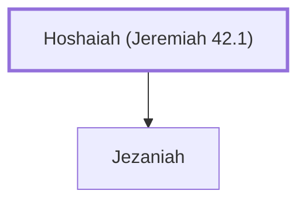

# Hoshaiah (Jeremiah 42.1)

A military leader during Jeremiah's time.

**Original-language names:** הוֹשַׁעֲיָה (H1955)

## When

- **Placed around:** [[connections/timeline/6th century BC|588 BC]] *(Ussher: the median date of the passages naming them)*

## Family

- **Children:** [[connections/people/Jezaniah|Jezaniah]]

**Family group:** [[connections/genealogy/Family of Hoshaiah (Jeremiah 42.1)|Family of Hoshaiah (Jeremiah 42.1)]], generation 1

## Appears in

[[connections/chapters/24-jeremiah/Jeremiah 42|Jeremiah 42]] · [[connections/chapters/24-jeremiah/Jeremiah 43|Jeremiah 43]]

## Appears in the same verse as

[[connections/people/Jezaniah|Jezaniah (2)]] · [[connections/people/Johanan (2 Kings 25.23)|Johanan (2 Kings 25.23) (2)]] · [[connections/people/Kareah|Kareah (2)]] · [[connections/people/Jeremiah (2 Chronicles 35.25)|Jeremiah (2 Chronicles 35.25)]] · [[connections/places/Egypt|Egypt]]
