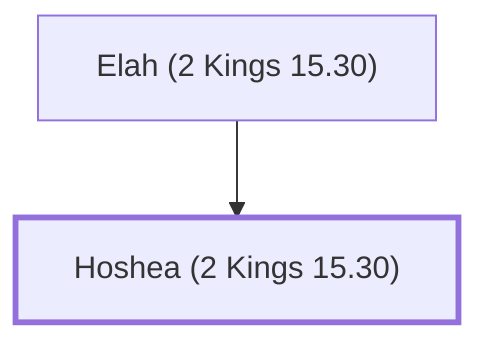

# Hoshea (2 Kings 15.30)

The last king of Israel (northern kingdom).

**Original-language names:** הוֹשֵׁעַ (H1954)

## When

- **Placed around:** [[connections/timeline/8th century BC|725 BC]] *(Ussher: the median date of the passages naming them)*

## Family

- **Father:** [[connections/people/Elah (2 Kings 15.30)|Elah (2 Kings 15.30)]]
- **Tribe or nation:** Israel

**Family group:** [[connections/genealogy/Family of Elah (2 Kings 15.30)|Family of Elah (2 Kings 15.30)]], generation 2

## Events

- [[connections/timeline/8th century BC|739 BC]] · [[connections/events/Death of Pekah|Death of Pekah]]
- [[connections/timeline/8th century BC|730 BC]] · [[connections/events/Reign of Hoshea|Reign of Hoshea]]

## Appears in

[[connections/chapters/12-2-kings/2 Kings 15|2 Kings 15]] · [[connections/chapters/12-2-kings/2 Kings 17|2 Kings 17 (4)]] · [[connections/chapters/12-2-kings/2 Kings 18|2 Kings 18 (3)]]

## Appears in the same verse as

[[connections/people/Israel|Israel (5)]] · [[connections/people/Elah (2 Kings 15.30)|Elah (2 Kings 15.30) (4)]] · [[connections/places/Assyria|Assyria (4)]] · [[connections/places/Samaria|Samaria (4)]] · [[connections/people/Hezekiah (2 Kings 16.20)|Hezekiah (2 Kings 16.20) (3)]] · [[connections/people/Ahaz (2 Kings 15.38)|Ahaz (2 Kings 15.38) (2)]] · [[connections/people/Judah (Genesis 29.35)|Judah (Genesis 29.35) (2)]] · [[connections/people/Shalmaneser|Shalmaneser (2)]] · [[connections/people/Jotham (2 Kings 15.5)|Jotham (2 Kings 15.5)]] · [[connections/people/Pekah|Pekah]] · [[connections/people/Remaliah|Remaliah]] · [[connections/people/So|So]] · [[connections/people/Uzziah (2 Kings 14.21)|Uzziah (2 Kings 14.21)]] · [[connections/places/Egypt|Egypt]] · [[connections/places/Gozan|Gozan]] · [[connections/places/Habor|Habor]] · [[connections/places/Halah|Halah]]
