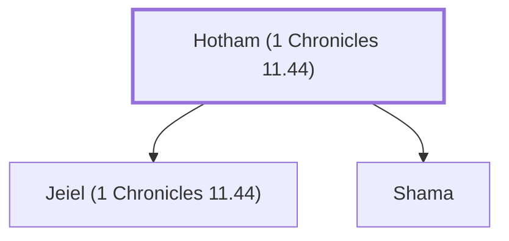

# Hotham (1 Chronicles 11.44)

One of David's mighty warriors from Aroer.

**Original-language names:** חוֹתָם (H2369)

## When

- **Placed around:** [[connections/timeline/11th century BC|1055 BC]] *(Ussher: the median date of the passages naming them)*

## Family

- **Children:** [[connections/people/Jeiel (1 Chronicles 11.44)|Jeiel (1 Chronicles 11.44)]], [[connections/people/Shama|Shama]]

**Family group:** [[connections/genealogy/Family of Hotham (1 Chronicles 11.44)|Family of Hotham (1 Chronicles 11.44)]], generation 1

## Appears in

[[connections/chapters/13-1-chronicles/1 Chronicles 11|1 Chronicles 11]]

## Appears in the same verse as

[[connections/people/Jeiel (1 Chronicles 11.44)|Jeiel (1 Chronicles 11.44)]] · [[connections/people/Shama|Shama]] · [[connections/people/Uzzia|Uzzia]]
