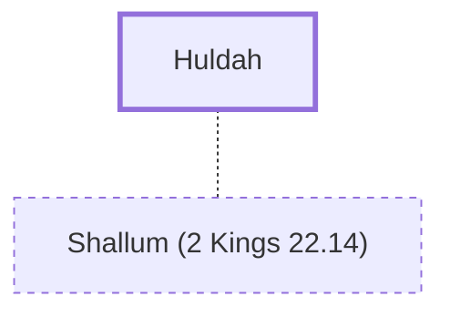

# Huldah

A prophetess during the reign of King Josiah.

**Original-language names:** חֻלְדָּה (H2468)

## When

- **Placed around:** [[connections/timeline/7th century BC|624 BC]] *(Ussher: the median date of the passages naming them)*

## Family

- **Spouses:** [[connections/people/Shallum (2 Kings 22.14)|Shallum (2 Kings 22.14)]]

## Appears in

[[connections/chapters/12-2-kings/2 Kings 22|2 Kings 22]] · [[connections/chapters/14-2-chronicles/2 Chronicles 34|2 Chronicles 34]]

## Appears in the same verse as

[[connections/people/Harhas|Harhas (2)]] · [[connections/people/Hilkiah (2 Kings 22.4)|Hilkiah (2 Kings 22.4) (2)]] · [[connections/people/Shallum (2 Kings 22.14)|Shallum (2 Kings 22.14) (2)]] · [[connections/people/Tikvah (2 Kings 22.14)|Tikvah (2 Kings 22.14) (2)]] · [[connections/places/Jerusalem|Jerusalem (2)]] · [[connections/places/Second Quarter|Second Quarter (2)]] · [[connections/people/Achbor (2 Kings 22.12)|Achbor (2 Kings 22.12)]] · [[connections/people/Ahikam|Ahikam]] · [[connections/people/Asaiah (2 Kings 22.12)|Asaiah (2 Kings 22.12)]] · [[connections/people/Shaphan (2 Kings 22.3)|Shaphan (2 Kings 22.3)]]
