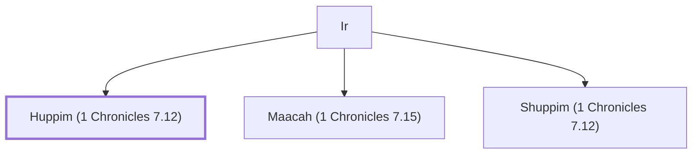

# Huppim (1 Chronicles 7.12)

A descendant of Manasseh.

**Original-language names:** חֻפִּים (H2650)

## Family

- **Father:** [[connections/people/Ir|Ir]]
- **Brothers and sisters:** [[connections/people/Maacah (1 Chronicles 7.15)|Maacah (1 Chronicles 7.15)]], [[connections/people/Shuppim (1 Chronicles 7.12)|Shuppim (1 Chronicles 7.12)]]
- **Tribe or nation:** Tribe of Benjamin(?)

**Family group:** [[connections/genealogy/Family of Adam|Family of Adam]], generation 2

## Appears in

[[connections/chapters/13-1-chronicles/1 Chronicles 7|1 Chronicles 7 (2)]]

## Appears in the same verse as

[[connections/people/Shuppim (1 Chronicles 7.12)|Shuppim (1 Chronicles 7.12) (2)]] · [[connections/people/Aher|Aher]] · [[connections/people/Hushim (1 Chronicles 7.12)|Hushim (1 Chronicles 7.12)]] · [[connections/people/Ir|Ir]] · [[connections/people/Maacah (1 Chronicles 7.15)|Maacah (1 Chronicles 7.15)]] · [[connections/people/Machir (Genesis 50.23)|Machir (Genesis 50.23)]] · [[connections/people/Zelophehad|Zelophehad]]
