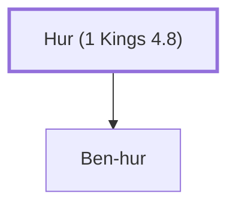

# Hur (1 Kings 4.8)

One of Solomon's twelve district governors.

**Original-language names:** בֶּן־חוּר (H1133)

## When

- **Placed around:** [[connections/timeline/11th century BC|1014 BC]] *(Ussher: the median date of the passages naming them)*

## Family

- **Children:** [[connections/people/Ben-hur|Ben-hur]]

**Family group:** [[connections/genealogy/Family of Hur (1 Kings 4.8)|Family of Hur (1 Kings 4.8)]], generation 1

## Appears in

[[connections/chapters/11-1-kings/1 Kings 4|1 Kings 4]]

## Appears in the same verse as

[[connections/people/Ben-hur|Ben-hur]] · [[connections/people/Ephraim|Ephraim]]
