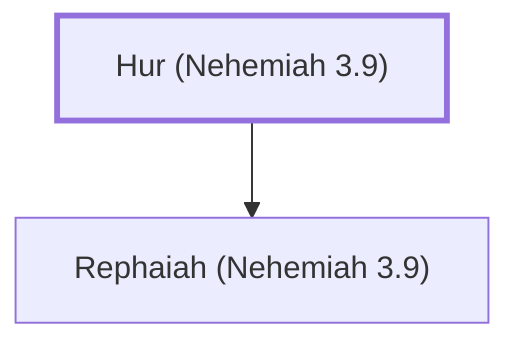

# Hur (Nehemiah 3.9)

A ruler who helped repair Jerusalem's wall.

**Original-language names:** חוּר (H2354)

## When

- **Placed around:** [[connections/timeline/5th century BC|445 BC]] *(Ussher: the median date of the passages naming them)*

## Family

- **Children:** [[connections/people/Rephaiah (Nehemiah 3.9)|Rephaiah (Nehemiah 3.9)]]

**Family group:** [[connections/genealogy/Family of Hur (Nehemiah 3.9)|Family of Hur (Nehemiah 3.9)]], generation 1

## Appears in

[[connections/chapters/16-nehemiah/Nehemiah 3|Nehemiah 3]]

## Appears in the same verse as

[[connections/people/Rephaiah (Nehemiah 3.9)|Rephaiah (Nehemiah 3.9)]] · [[connections/places/Jerusalem|Jerusalem]]
