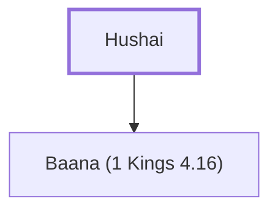

# Hushai

David's friend and advisor who helped him during Absalom's rebellion.

**Original-language names:** חוּשַׁי (H2365)

## When

- **Placed around:** [[connections/timeline/11th century BC|1023 BC]] *(Ussher: the median date of the passages naming them)*

## Family

- **Children:** [[connections/people/Baana (1 Kings 4.16)|Baana (1 Kings 4.16)]]

**Family group:** [[connections/genealogy/Family of Hushai|Family of Hushai]], generation 1

## Appears in

[[connections/chapters/10-2-samuel/2 Samuel 15|2 Samuel 15 (2)]] · [[connections/chapters/10-2-samuel/2 Samuel 16|2 Samuel 16 (3)]] · [[connections/chapters/10-2-samuel/2 Samuel 17|2 Samuel 17 (6)]] · [[connections/chapters/11-1-kings/1 Kings 4|1 Kings 4]] · [[connections/chapters/13-1-chronicles/1 Chronicles 27|1 Chronicles 27]]

## Appears in the same verse as

[[connections/people/Absalom|Absalom (9)]] · [[connections/people/Ahithophel|Ahithophel (5)]] · [[connections/people/David|David (3)]] · [[connections/people/Israel|Israel (3)]] · [[connections/people/Abiathar|Abiathar]] · [[connections/people/Asher|Asher]] · [[connections/people/Baana (1 Kings 4.16)|Baana (1 Kings 4.16)]] · [[connections/people/Zadok (2 Samuel 8.17)|Zadok (2 Samuel 8.17)]] · [[connections/places/Baalath-beer|Baalath-beer]] · [[connections/places/Jerusalem|Jerusalem]]
