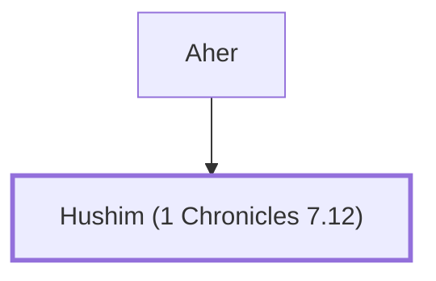

# Hushim (1 Chronicles 7.12)

A son of Aher, from the tribe of Dan.

**Original-language names:** חֻשִׁים (H2366b)

## Family

- **Father:** [[connections/people/Aher|Aher]]
- **Tribe or nation:** Tribe of Benjamin(?)

**Family group:** [[connections/genealogy/Family of Aher|Family of Aher]], generation 2

## Appears in

[[connections/chapters/13-1-chronicles/1 Chronicles 7|1 Chronicles 7]]

## Appears in the same verse as

[[connections/people/Aher|Aher]] · [[connections/people/Huppim (1 Chronicles 7.12)|Huppim (1 Chronicles 7.12)]] · [[connections/people/Ir|Ir]] · [[connections/people/Shuppim (1 Chronicles 7.12)|Shuppim (1 Chronicles 7.12)]]
