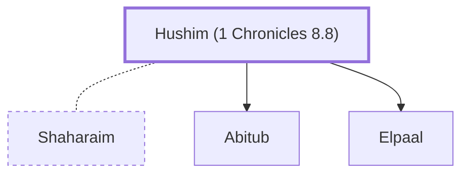

# Hushim (1 Chronicles 8.8)

A son of Shaharaim, a Benjamite.

**Original-language names:** חוּשִׁים (H2366a)

## Family

- **Spouses:** [[connections/people/Shaharaim|Shaharaim]]
- **Children:** [[connections/people/Abitub|Abitub]], [[connections/people/Elpaal|Elpaal]]
- **Tribe or nation:** Tribe of Benjamin

**Family group:** [[connections/genealogy/Family of Shaharaim|Family of Shaharaim]], generation 1

## Appears in

[[connections/chapters/13-1-chronicles/1 Chronicles 8|1 Chronicles 8 (2)]]

## Appears in the same verse as

[[connections/people/Abitub|Abitub]] · [[connections/people/Baara|Baara]] · [[connections/people/Elpaal|Elpaal]] · [[connections/people/Shaharaim|Shaharaim]] · [[connections/places/Moab|Moab]]
