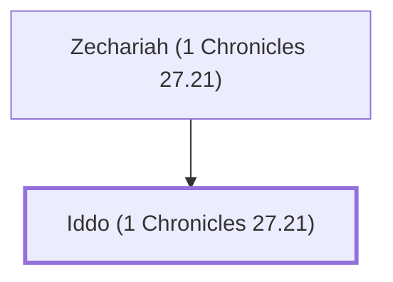

# Iddo (1 Chronicles 27.21)

Zechariah's son, a leader of Manasseh

**Original-language names:** יִדּוֹ (H3035)

## When

- **Placed around:** [[connections/timeline/11th century BC|1015 BC]] *(Ussher: the median date of the passages naming them)*

## Family

- **Father:** [[connections/people/Zechariah (1 Chronicles 27.21)|Zechariah (1 Chronicles 27.21)]]

**Family group:** [[connections/genealogy/Family of Zechariah (1 Chronicles 27.21)|Family of Zechariah (1 Chronicles 27.21)]], generation 2

## Appears in

[[connections/chapters/13-1-chronicles/1 Chronicles 27|1 Chronicles 27]]

## Appears in the same verse as

[[connections/people/Abner|Abner]] · [[connections/people/Benjamin (Genesis 35.18)|Benjamin (Genesis 35.18)]] · [[connections/people/Jaasiel (1 Chronicles 27.21)|Jaasiel (1 Chronicles 27.21)]] · [[connections/people/Manasseh (Genesis 41.51)|Manasseh (Genesis 41.51)]] · [[connections/people/Zechariah (1 Chronicles 27.21)|Zechariah (1 Chronicles 27.21)]] · [[connections/places/Gilead|Gilead]]
