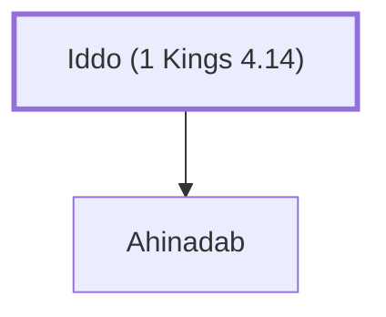

# Iddo (1 Kings 4.14)

Abinadab's son, an official under King Solomon

**Original-language names:** עִדּוֹ (H5714)

## When

- **Placed around:** [[connections/timeline/11th century BC|1014 BC]] *(Ussher: the median date of the passages naming them)*

## Family

- **Children:** [[connections/people/Ahinadab|Ahinadab]]

**Family group:** [[connections/genealogy/Family of Iddo (1 Kings 4.14)|Family of Iddo (1 Kings 4.14)]], generation 1

## Appears in

[[connections/chapters/11-1-kings/1 Kings 4|1 Kings 4]]

## Appears in the same verse as

[[connections/people/Ahinadab|Ahinadab]] · [[connections/places/Mahanaim|Mahanaim]]
