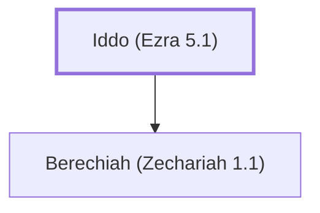

# Iddo (Ezra 5.1)

Zechariah's grandfather, a priest and prophet in post-exilic Judah

**Original-language names:** עִדּוֹ (H5714)

## When

- **Placed around:** [[connections/timeline/6th century BC|519 BC]] *(Ussher: the median date of the passages naming them)*

## Family

- **Children:** [[connections/people/Berechiah (Zechariah 1.1)|Berechiah (Zechariah 1.1)]]

**Family group:** [[connections/genealogy/Family of Iddo (Ezra 5.1)|Family of Iddo (Ezra 5.1)]], generation 1

## Appears in

[[connections/chapters/15-ezra/Ezra 5|Ezra 5]] · [[connections/chapters/15-ezra/Ezra 6|Ezra 6]] · [[connections/chapters/38-zechariah/Zechariah 1|Zechariah 1 (2)]]

## Appears in the same verse as

[[connections/people/Zechariah (Ezra 5.1)|Zechariah (Ezra 5.1) (4)]] · [[connections/people/Darius (Ezra 4.5)|Darius (Ezra 4.5) (3)]] · [[connections/people/Berechiah (Zechariah 1.1)|Berechiah (Zechariah 1.1) (2)]] · [[connections/people/Haggai|Haggai (2)]] · [[connections/people/Israel|Israel (2)]] · [[connections/people/Judah (Genesis 29.35)|Judah (Genesis 29.35) (2)]] · [[connections/people/Artaxerxes|Artaxerxes]] · [[connections/people/Cyrus|Cyrus]] · [[connections/places/Jerusalem|Jerusalem]] · [[connections/places/Judea|Judea]] · [[connections/places/Persia|Persia]]
