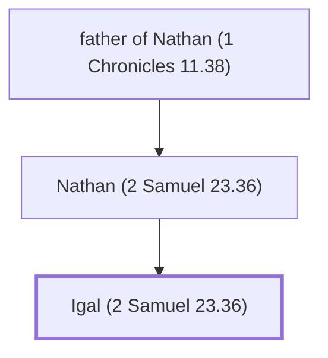

# Igal (2 Samuel 23.36)

One of David's mighty warriors.

**Original-language names:** יִגְאָל (H3008)

## When

- **Placed around:** [[connections/timeline/11th century BC|1055 BC]] *(Ussher: the median date of the passages naming them)*

## Family

- **Father:** [[connections/people/Nathan (2 Samuel 23.36)|Nathan (2 Samuel 23.36)]]

**Line of descent** (3 generations, father to son): [[connections/people/father of Nathan (1 Chronicles 11.38)|father of Nathan (1 Chronicles 11.38)]] → [[connections/people/Nathan (2 Samuel 23.36)|Nathan (2 Samuel 23.36)]] → **Igal (2 Samuel 23.36)**

**Family group:** [[connections/genealogy/Family of father of Nathan (1 Chronicles 11.38)|Family of father of Nathan (1 Chronicles 11.38)]], generation 3

## Appears in

[[connections/chapters/10-2-samuel/2 Samuel 23|2 Samuel 23]]

## Appears in the same verse as

[[connections/people/Bani (2 Samuel 23.36)|Bani (2 Samuel 23.36)]] · [[connections/people/Nathan (2 Samuel 23.36)|Nathan (2 Samuel 23.36)]] · [[connections/places/Zobah|Zobah]]
