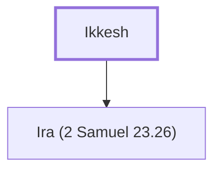

# Ikkesh

Father of Ira, one of David's mighty warriors.

**Original-language names:** עִקֵּשׁ (H6142)

## When

- **Placed around:** [[connections/timeline/11th century BC|1055 BC]] *(Ussher: the median date of the passages naming them)*

## Family

- **Children:** [[connections/people/Ira (2 Samuel 23.26)|Ira (2 Samuel 23.26)]]

**Family group:** [[connections/genealogy/Family of Ikkesh|Family of Ikkesh]], generation 1

## Appears in

[[connections/chapters/10-2-samuel/2 Samuel 23|2 Samuel 23]] · [[connections/chapters/13-1-chronicles/1 Chronicles 11|1 Chronicles 11]] · [[connections/chapters/13-1-chronicles/1 Chronicles 27|1 Chronicles 27]]

## Appears in the same verse as

[[connections/people/Ira (2 Samuel 23.26)|Ira (2 Samuel 23.26) (3)]] · [[connections/people/Abiezer (2 Samuel 23.27)|Abiezer (2 Samuel 23.27)]] · [[connections/people/Helez (2 Samuel 23.26)|Helez (2 Samuel 23.26)]] · [[connections/places/Anathoth|Anathoth]]
